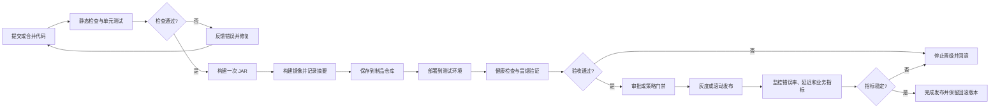

# CI/CD 与可靠发布：从一次提交到可回滚服务

CI/CD 把代码检查、构建、测试、制品保存和部署连成可重复的流程。它解决“每个人手工发布步骤不同、忘记测试、生产跑的包和测试的包不是同一个、出错后不知道怎么退回”的问题。

本页介绍通用工程方法。下方的 GitHub Actions 和 Shell 是**教学模板**，不代表 `datacenter-cloud` 已配置这些流水线，也不能直接连接真实生产环境。项目发布方式仍要以实际 CI 平台、权限、镜像仓库和部署平台为准。

## 一条发布流水线的全景



图里的 CI（持续集成）重点是尽早发现变更问题并生成可追踪产物；CD（持续交付/部署）重点是把经过验证的产物安全地送到目标环境。持续交付通常保留人工或策略审批；持续部署则可能在检查通过后自动发布，两者的授权和风险不同。

## 阶段、输入与验收信号

| 阶段 | 输入 | 主要工作 | 通过信号 | 常见失败边界 |
|---|---|---|---|---|
| 触发与隔离 | commit、PR/MR、分支规则 | 固定源码版本、区分可信分支和外部贡献 | 记录 commit SHA、触发人和流水线运行号 | 外部 PR 不应自动拿到部署密钥 |
| 代码检查 | 源码、格式规则、静态分析配置 | 编译、单元测试、依赖与漏洞检查 | 失败能定位到任务和日志 | 只编译不等于测试通过；测试也可能漏掉真实数据库行为 |
| 构建 | 固定 JDK、Maven、依赖版本 | 从已检查源码生成 JAR | 保存构建日志、版本和测试报告 | 浮动依赖、不同 JDK 或 Profile 会造成不可复现 |
| 制品封装 | JAR、Dockerfile、基础镜像 | 生成容器镜像，标记 commit 与版本 | 镜像仓库返回 tag 和不可变 digest | 用 `latest` 无法可靠说明实际运行内容 |
| 测试环境 | 制品 digest、环境配置、测试数据 | 部署并执行健康检查、冒烟和集成验证 | readiness 正常、关键 API 与业务检查通过 | 探针正常只表示探针所检查的条件满足 |
| 生产晋级 | 已验收的同一个 digest | 审批、灰度、滚动或蓝绿切换 | 新旧版本比例和错误/延迟指标符合门槛 | 在生产重新构建会破坏“同一产物晋级”的证据链 |
| 发布观察 | 版本、部署事件、日志和指标 | 监控错误率、延迟、资源、业务结果 | 观察窗口通过且可关联版本 | 只看 HTTP 200 会漏掉业务 code 错误或数据异常 |
| 回退或修复 | 上一稳定版本、兼容数据结构 | 回滚代码/镜像，或发布修复版本 | 服务恢复且数据状态可解释 | 数据库变更和外部副作用通常不能随镜像自动回滚 |

## 先定义“同一个产物”

推荐的晋级模型是：对某个 commit 构建一次 JAR 和镜像，在测试环境验证后，把**相同镜像 digest** 晋级到预发布和生产。环境差异通过运行时配置、Secret 和服务发现注入，不通过重新编译或改镜像来实现。

- **版本标签**便于人阅读，例如 `1.4.2` 或 commit 短 SHA；应避免让可变标签承担唯一追踪责任。
- **Digest** 是镜像内容摘要，部署时记录它可以确认实际运行的镜像内容。
- **构建记录**应关联源码 commit、JDK/Maven 版本、依赖锁定情况、测试结果和制品地址。
- **制品仓库**保存经过验证的 JAR、镜像和相关构建元数据，并按保留策略清理旧版本。
- 大型组织还可在制品阶段加入 SBOM、漏洞扫描和签名验证；这些措施要接入真实仓库和部署策略才会生效。

生产服务器通常不应临时拉源码执行 `mvn package`。这样会让线上环境同时承担构建、依赖下载和发布职责，难以证明测试的代码就是正在运行的代码。

### Maven 示例：先验证，再生成产物

```sh
# 在包含聚合 pom.xml 的仓库根目录执行；若仓库提供 Maven Wrapper，优先用 Wrapper 固定 Maven 版本。
mvn -B -pl gykj-modules/gykj-dashboard -am clean verify

# 查看当前模块生成的 JAR；具体路径取决于模块和打包配置。
ls gykj-modules/gykj-dashboard/target/*.jar
```

Windows PowerShell 可把第一条命令改为 `mvn -B -pl gykj-modules/gykj-dashboard -am clean verify`；若仓库提供 `mvnw.cmd`，则运行 `.\mvnw.cmd -B -pl gykj-modules/gykj-dashboard -am clean verify`。构建机应固定 JDK 和 Maven 版本。`verify` 会运行绑定在该生命周期及之前的任务，但不能证明外部服务、生产配置和真实浏览器链路都正常。

### 镜像命令示意

下面使用示例仓库地址和版本变量。正式流水线应由 CI 平台安全地登录私有仓库，构建成功后保存 registry 返回的 digest；不要把账号密码写入脚本参数、Dockerfile 或镜像环境变量。

```sh
# 用当前提交 SHA 作为可追踪标签；CI 应保证该值来自受控的源码 checkout。
IMAGE_TAG="registry.example.test/team/dashboard:${GIT_COMMIT_SHA}"

# 从已验证的 JAR 构建运行镜像；Dockerfile 和上下文路径按真实模块调整。
docker build --pull -t "$IMAGE_TAG" -f docker/dashboard/Dockerfile .

# 推送镜像到受控仓库；执行前由 CI 身份完成登录和仓库权限校验。
docker push "$IMAGE_TAG"

# 查询仓库记录的镜像摘要，部署系统应使用不可变 digest 或受控的版本引用。
docker image inspect --format '{{index .RepoDigests 0}}' "$IMAGE_TAG"
```

此命令假设 CI 环境提供 `GIT_COMMIT_SHA`，而实际项目路径、Dockerfile 和仓库地址需要核实。Shell 变量语法只适用于 Bash；不要原样复制到 Windows PowerShell。

## 配置与密钥要在运行时注入

镜像应该包含应用和启动所需文件，不应包含环境口令。数据库地址、Nacos 地址、功能开关等配置按环境注入；密码、Token、证书私钥通过 CI Secret 或部署平台 Secret 引用。CI Secret 的可见范围要按环境限制，Fork PR、普通构建任务和生产发布任务应使用不同权限。

```yaml
# 以下是 GitHub Actions 风格的教学片段，不是本项目现有流水线。
name: backend-ci

on:
  # Pull Request 阶段只做验证，不发布生产凭据。
  pull_request:
    branches: [main]
  # 合并到主分支后执行受控的构建工作。
  push:
    branches: [main]

permissions:
  # 仓库内容只读，避免构建任务获得多余写权限。
  contents: read

jobs:
  verify:
    # 使用隔离的临时 runner；实际 runner 由组织策略决定。
    runs-on: ubuntu-latest
    steps:
      # 固定 checkout 到触发本次任务的 commit。
      - uses: actions/checkout@v4
      # 安装项目要求的 JDK；Java 版本必须与项目基线相符。
      - uses: actions/setup-java@v4
        with:
          distribution: temurin
          java-version: '11'
          cache: maven
      # 运行器应预装团队固定版本的 Maven；若仓库带 Maven Wrapper，应改为调用 mvnw。
      - name: Verify modules
        run: mvn -B -pl gykj-modules/gykj-dashboard -am clean verify

  # 镜像发布应是独立的受控 job，并且只消费 verify 成功的同一 commit。
  # 私有仓库登录、镜像构建、digest 记录和部署步骤需要按团队平台配置。
```

实际项目若使用 Jenkins、GitLab CI、Azure Pipelines 或其他平台，应按其权限模型转换示例。不要只复制 YAML：还需要检查触发条件、分支保护、任务权限、构建缓存隔离、第三方 Action/插件版本和日志脱敏。

## 部署前要有健康门禁

进程存在、容器 `Up`、端口可连接都不能单独证明应用可接流量。部署平台常用三类探针：

| 探针 | 它回答的问题 | 失败时的典型动作 |
|---|---|---|
| Startup | 应用是否完成较慢的启动过程 | 启动期限内持续失败则停止或重启实例 |
| Liveness | 进程是否陷入无法自行恢复的状态 | 按平台策略重启进程 |
| Readiness | 实例当前是否准备好接收业务流量 | 暂时从负载均衡摘除，恢复后再加入 |

探针应快速、低副作用，并且只检查与目标含义相符的条件。Readiness 可检查必须依赖，但如果把所有下游瞬时抖动都作为 liveness 条件，可能导致重启风暴；反过来，只检查 TCP 端口也可能让启动失败的服务接流量。

部署后的冒烟验证还应覆盖真实业务契约，例如只读健康 API、认证路径、关键列表查询和错误响应格式。测试数据和账号要使用隔离环境的虚构数据；不要在冒烟测试中触发真实支付、发送真实通知或写生产业务数据。

## 选择发布策略并限制影响面

| 策略 | 工作方式 | 适合场景 | 主要风险与门禁 |
|---|---|---|---|
| 停机再启动 | 先停止旧实例，再启动新实例 | 维护窗口、单机内网工具 | 会中断请求；要设置维护提示和恢复验收 |
| 滚动发布 | 分批替换实例，逐批确认健康 | 有多个同版本可替换的服务实例 | 新旧代码短时间并存；接口和数据库要兼容 |
| 蓝绿发布 | 同时运行新旧两组，切换流量入口 | 需要较快切回且有资源运行两套实例 | 数据库通常共用；不能假设代码回滚能撤销写入 |
| 金丝雀/灰度 | 先给小比例用户或流量使用新版本 | 高风险改动、需要真实流量观察 | 样本过少会漏问题；需定义分组、指标阈值和停止条件 |

具体采用哪种策略由部署平台决定。发布前要明确：新旧版本是否能同时访问同一数据库；是否有 WebSocket、长任务或消费者；负载均衡何时摘除实例；停止时如何等待在途请求；发布失败由谁或什么规则停止后续批次。

### 发布观察与自动停止条件

将版本号或 commit SHA 写入应用日志、指标和部署事件，才能把“页面错误变多”与具体发布关联。观察窗口至少关注：

- HTTP 4xx/5xx、业务错误码、超时和重试变化。
- P95/P99 延迟、线程池队列、数据库连接池等待和下游调用失败。
- 关键业务计数是否符合预期，例如创建成功与失败比例；只看健康端点可能漏掉业务错误。
- 发布实例数量、未就绪数量、消息积压、任务失败和资源使用趋势。

阈值需要根据现有基线、SLO 和流量规模定义。灰度期间如果指标超出门槛，应停止扩大流量；自动化回滚也需要确认它不会重复触发有副作用的恢复操作。

## 回滚不是万能撤销

回滚镜像适用于新代码可以与当前数据库结构和已写入数据兼容的情况。它不会自动撤销数据库提交、消息投递、第三方支付、邮件发送或用户已经看到的结果。发布流程必须将代码回退和数据修复分开设计。

数据库变更常用 **扩展—迁移—收缩（expand-migrate-contract）**：

1. **扩展：** 先添加可选字段、索引或新表，避免立即删除旧字段；新旧代码都能继续工作。
2. **迁移：** 以可观测、可重跑的批次回填数据；验证计数、空值和业务规则。
3. **切换：** 发布同时兼容旧/新结构的应用版本，逐步让读写转到新结构。
4. **收缩：** 等旧版本彻底退出、回滚窗口结束后，再删除旧字段或兼容逻辑。

不要把“运行了向下 migration 脚本”当作无损回滚；删除或改写后的数据通常不能靠数据库结构脚本恢复。重要变更前要验证备份可恢复、定义恢复点，并准备可审阅的前滚修复方案。

一次发布失败时，先停止后续扩流，确认失败实例和影响范围，保留日志/版本证据，再按预案切回兼容镜像或发布修复。不要直接手工修改容器文件或线上数据库来掩盖状态；这些操作会让实际环境偏离版本控制和审计记录。

## 安全与审计边界

- 使用最小权限：构建 job 只读源码；推镜像的 job 仅能写指定仓库；生产部署由单独身份执行。
- Secret 只在需要它的任务中短时注入，日志中禁止输出；轮换和访问记录按组织要求管理。
- 不要在 Dockerfile `ARG`、`ENV`、构建日志、JUnit 报告或制品元数据中写入口令和个人数据。
- 锁定基础镜像、依赖和流水线插件版本；升级前评估兼容性并记录来源。
- 对部署脚本、迁移 SQL 和外部 PR 代码做审阅；外部贡献不得借流水线拿到生产 Secret。
- 保留谁批准、部署了哪个 commit/digest、部署到哪个环境、健康检查结果和回滚原因。

## 与当前项目文档的关系

可以沿 [Git](./git.md)、[Maven](./maven.md)、[Docker](./docker.md)、[Linux](./linux.md)、[Nginx](./nginx.md) 逐步理解流水线的工具环节，再看[部署总览](./operations.md)和[项目地图](../project-map.md)确认 `datacenter-cloud` 的 Maven 模块、Compose 文件、Dockerfile 与启动脚本。

当前资料描述的是仓库结构和部署线索；不能据此断定某一分支已配置 CI/CD、具备灰度平台或完成生产回滚演练。要确认实际能力，需检查对应的流水线配置、制品仓库记录、部署平台策略、权限设置和最近一次演练证据。

## 练习：设计一条安全的测试发布

1. 选一个无副作用的 Java 模块，写出从 Git commit 到 Maven `verify` 的触发和通过条件。
2. 说明 JAR 和镜像如何记录 commit、版本与 digest，以及测试/生产如何使用同一镜像。
3. 列出哪些设置属于普通配置，哪些是 Secret，分别由谁提供给运行容器。
4. 为一个只读 API 设计 readiness、部署后冒烟请求和错误率观察条件。
5. 假设新版本需要新增数据库字段，写出新旧版本共存的扩展—迁移—收缩顺序和停止发布条件。
6. 画出无法回滚数据库数据时的前滚修复路径，并说明如何保留审计记录。

继续学习：[Docker 与 Compose](./docker.md)、[运行部署总览](./operations.md)、[微服务与消息系统](./distributed.md)。
