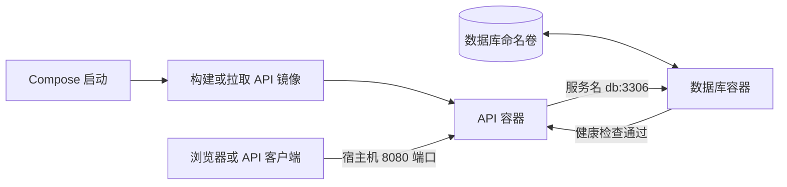

# Docker：镜像、容器与多服务本地运行

Docker 镜像封装应用和运行所需文件；容器从镜像启动，并通过环境变量、端口、网络和卷与宿主机交互。

它解决“本地能运行，部署机器缺少环境或依赖版本不同”的问题。容器不是完整部署平台，也不会自动保证数据持久化或服务健康。

## 镜像、容器、构建上下文和网络

镜像是由只读层组成的应用模板；容器是镜像启动后的进程和可写层。删除容器通常会丢掉容器可写层，因此数据库、用户上传文件和需要跨重建保存的数据应写入卷或外部存储。镜像仓库存放可按版本拉取的镜像；CI 构建完成后，部署环境应拉取同一个不可变产物，而不是在生产服务器临时编译源码。

`docker build` 的构建上下文是发送给 Docker daemon 的文件集合。`.dockerignore` 应排除 `.git`、本地构建目录、日志、密钥和无关文件，减少镜像泄露与无效传输。`COPY` 顺序会影响缓存：变化频繁的源码尽量不要放在依赖清单之前，以便复用依赖层。

容器内部的 `localhost` 指该容器自己。Compose 网络中的服务通常用服务名互相寻址，例如 API 连接数据库的主机名应是 `db`，而不是 `localhost`；宿主机浏览器才通过 `ports` 映射访问宿主机端口。`EXPOSE` 是镜像元信息，不会自动发布端口，也不是防火墙规则。

~~~dockerfile
# 使用维护中的 JRE 基础镜像；生产项目应固定经过审查的版本。
FROM eclipse-temurin:17-jre

# 创建低权限服务账号，降低应用进程权限。
RUN useradd --system --create-home appuser

# 将构建产物复制到镜像；构建阶段应先生成这个 JAR。
COPY target/app.jar /opt/app/app.jar

# 声明应用容器内部监听端口，不会自动发布宿主机端口。
EXPOSE 8080

# 切换为非 root 用户运行服务。
USER appuser

# 使用 exec 形式启动，使容器能正确传递停止信号给 Java。
ENTRYPOINT ["java", "-jar", "/opt/app/app.jar"]
~~~

**取舍与注意：**

- 容器可重建，上传文件、数据库文件等要用持久化卷或外部存储。
- 配置和密钥通过受控环境变量或 Secret 注入，不要写进镜像层。
- EXPOSE 只是端口元数据，运行或编排时仍需发布端口。
- 不要把本地 .env、密钥和无关缓存放入构建上下文。
- 健康检查要验证必要依赖和服务行为，不能只确认进程存在。

## 多阶段构建：把构建工具留在构建阶段

```dockerfile
# 构建阶段包含 Maven 和 JDK，用来编译应用；运行阶段不复制这些工具。
FROM maven:3.9-eclipse-temurin-17 AS build

# 使用固定工作目录，便于 COPY 和构建命令保持可读。
WORKDIR /workspace

# 教学示例按标准单模块项目复制源码；多模块仓库要复制参与构建的相关模块和父 POM。
COPY pom.xml .
COPY src ./src

# 在镜像构建时生成可执行 JAR；CI 仍需单独运行并报告测试结果。
RUN mvn -B -DskipTests package

# 运行阶段只使用 JRE，减少镜像体积和运行时工具面。
FROM eclipse-temurin:17-jre

# 创建应用目录并设置后续相对路径基准。
WORKDIR /app

# 复制构建阶段生成的 JAR，而不是把 Maven 缓存和完整源码带进运行镜像。
COPY --from=build /workspace/target/app.jar /app/app.jar

# 以非 root 用户启动服务，减少容器被利用后的权限范围。
USER 10001:10001

# 记录容器内服务端口；发布到宿主机仍需运行参数或 Compose ports 配置。
EXPOSE 8080

# 使用 exec 形式让 Java 进程直接接收容器停止信号。
ENTRYPOINT ["java", "-jar", "/app/app.jar"]
```

实际项目可能需要先复制父 POM、模块 POM 和多个模块源码，或直接由 CI 构建 JAR 后只构建运行镜像。镜像应使用可追踪的版本标签或摘要；`latest` 会随时间指向不同内容，不能作为可靠回滚标识。不要把密码放进 Dockerfile 的 `ARG`、`ENV` 或镜像层。

## Docker Compose：描述本地多服务关系

Compose 便于在开发/测试环境描述 API、数据库、缓存、网络和持久化卷。下面是结构示例，变量应放在受控且被 Git 忽略的本地环境文件中；生产密钥应使用部署平台的 Secret 能力。

```yaml
services:
  api:
    # 使用可追踪版本；不要依赖会移动的 latest 标签作为发布版本。
    image: example/backend:${APP_VERSION:?set APP_VERSION}
    # 仅将 API 端口发布给宿主机；数据库仍留在 Compose 私有网络。
    ports:
      - "8080:8080"
    # 通过环境变量注入配置，仓库中不保存真实口令。
    environment:
      DB_URL: ${DB_URL:?set DB_URL}
      DB_PASSWORD: ${DB_PASSWORD:?set DB_PASSWORD}
    # 等数据库健康检查通过后再启动 API；应用仍需处理运行期间依赖重启。
    depends_on:
      db:
        condition: service_healthy
    # API 和数据库连接到同一 Compose 网络，并通过服务名通信。
    networks:
      - backend

  db:
    # 示例标明数据库主版本线；正式构建应锁定经过项目验证的 patch 版本或镜像 digest。
    image: mysql:8.0
    # 示例用于本地开发；不要在文档或提交文件中填入真实密码。
    environment:
      MYSQL_DATABASE: app
      MYSQL_ROOT_PASSWORD: ${MYSQL_ROOT_PASSWORD:?set MYSQL_ROOT_PASSWORD}
    # 命名卷在容器重建后保留数据库文件。
    volumes:
      - mysql-data:/var/lib/mysql
    # 检查数据库进程是否响应探测；它不验证账号、schema 或业务查询是否已准备好。
    healthcheck:
      test: ["CMD-SHELL", "mysqladmin ping -h 127.0.0.1 --silent"]
      interval: 10s
      timeout: 3s
      retries: 10
    # 不映射数据库端口到宿主机，容器间通过服务名 db 访问。
    networks:
      - backend

networks:
  # Compose 为这个项目创建专用 bridge 网络；它不等于生产防火墙策略。
  backend:

volumes:
  # Docker 管理数据库持久化数据，不随 API 容器替换而消失。
  mysql-data:
```

```sh
# 在 Compose 文件所在目录构建镜像并启动服务。
docker compose up --build -d

# 查看服务状态，检查容器是否运行以及健康检查结果。
docker compose ps

# 查看 API 最近日志，排查启动配置或依赖连接错误。
docker compose logs --tail=200 api

# 停止并移除容器和网络；默认保留命名卷中的数据库数据。
docker compose down
```

`depends_on` 解决启动顺序，不保证数据库业务 schema、迁移和连接池都已就绪；服务启动后仍要做有上限的连接重试。命名卷用于持久数据，容器可替换；确认数据可恢复前不要删除卷。Compose 的 `version` 字段在现代 Compose 中已不再需要，项目旧配置可能仍保留兼容写法。

下面的图说明 Compose 启动时怎样连接 API、数据库、宿主机端口和持久卷，也展示一次浏览器请求如何到达 API 并访问数据库。数据库健康检查通过只代表探测命令成功；应用仍需要处理账号、schema、迁移和运行中依赖故障。



## Docker 常用命令速查

先区分 Docker 命令操作的对象：镜像是可复用的模板，容器是运行实例，卷负责持久化数据，网络负责容器间通信。排查时先用只读命令收集状态，再决定是否需要重启或替换容器。

### 查看容器状态与日志

```sh
# 显示 Docker 客户端和服务端版本，确认 CLI 与 Docker Engine 是否兼容。
docker version

# 查看 Engine 的运行环境、存储驱动和资源信息；用于确认当前连接的是哪个 Docker 环境。
docker info

# 只列出正在运行的容器；PORTS 列可检查宿主机端口映射，STATUS 可看到运行时长。
docker ps

# 列出运行中和已退出的容器；排查“容器启动后马上退出”时要加 -a。
docker ps -a

# 按容器名或 ID 查看最近 200 行日志；日志中可能包含敏感业务数据，分享前先脱敏。
docker logs --tail 200 backend-api

# 持续跟随最近 100 行日志，适合复现请求时观察启动错误或接口异常。
docker logs --tail 100 --follow backend-api

# 查看容器的实际端口映射，例如 8080/tcp 映射到宿主机哪个地址和端口。
docker port backend-api

# 只读地查看容器运行时配置；格式化输出状态和重启次数，辅助判断是否反复重启。
docker inspect --format '{{.State.Status}} restart={{.RestartCount}}' backend-api

# 实时查看容器的 CPU、内存和网络统计；看到资源接近上限时应继续检查应用和限制配置。
docker stats --no-stream backend-api
```

`docker exec` 会在运行中的容器里启动新进程，适合做受控的临时诊断；它不会自动把改动写回镜像，也不适合作为长期配置方式。

```sh
# 在容器内执行只读诊断命令，检查 Java 进程；精简镜像可能没有 ps 等工具。
docker exec backend-api sh -c 'ps'

# 交互式进入容器 shell 用于临时检查；输入 exit 退出，不要在生产容器里手工改文件修复问题。
docker exec -it backend-api sh
```

### 镜像、构建和清理

| 命令 | 用途与场景 | 如何判断 |
|---|---|---|
| `docker image ls` | 查看本机镜像、标签和占用 | 对照发布标签与更新时间；同名不同 tag 可能是不同版本 |
| `docker image inspect IMAGE:TAG` | 只读查看镜像元数据、入口命令和层信息 | 核对镜像 ID、架构、入口点等是否符合部署预期 |
| `docker history IMAGE:TAG` | 查看镜像层的构建历史 | 若某层意外包含密钥、源码或大型缓存，停止发布并检查 Dockerfile |
| `docker pull IMAGE:TAG` | 从仓库下载指定标签 | 看是否拉取成功及摘要；生产应记录不可变 digest |
| `docker build -t backend:dev .` | 以当前目录为构建上下文构建本地开发镜像 | 成功生成镜像后用 `docker image ls` 确认；末尾 `.` 表示上下文目录 |
| `docker tag backend:dev registry.example.test/team/backend:1.2.3` | 为本地镜像增加仓库地址与发布标签 | tag 只增加引用，不会重新构建镜像 |
| `docker push registry.example.test/team/backend:1.2.3` | 上传镜像到仓库 | 需要已登录且有权限；检查所有层上传完成和最终 digest |

清理命令可能删除以后还要用的镜像、缓存或数据。先用 `docker system df` 了解空间，再按项目保留策略清理；`docker system prune`、`docker image prune`、`docker volume prune` 会删除资源，尤其卷可能包含数据库数据，不要把它们当作普通排错命令。

```sh
# 只读查看镜像、容器、卷和构建缓存的大致磁盘占用。
docker system df

# 查看某个镜像的构建历史，检查异常的大层或不应进入运行镜像的内容。
docker history --no-trunc backend:dev
```

### 网络与卷

```sh
# 查看 Docker 网络，确认 Compose 项目是否创建了预期网络。
docker network ls

# 只读检查网络中的容器成员；用于排查 API 与数据库是否接入同一网络。
docker network inspect backend-learning_default

# 查看命名卷及其元数据，不会删除或修改其中的数据。
docker volume ls

# 检查指定卷的驱动和挂载点；宿主机实际路径因平台和 Docker 配置而异。
docker volume inspect backend-learning_mysql-data

# 查看容器的挂载关系，确认数据库目录是否映射到命名卷或宿主机目录。
docker inspect --format '{{json .Mounts}}' backend-db
```

不要直接编辑 Docker Desktop 管理的卷内部文件；通过数据库客户端、备份恢复流程或受控临时容器处理数据。排查“容器重建后数据消失”时，先确认应用实际写入路径是否就是卷的挂载目标。

### Compose 日常开发与排错

在项目根目录执行 Compose 命令，或用 `-f` 明确指定配置文件。多份 Compose 文件、环境变量和 profile 可能改变最终配置，因此先查看解析结果。

```sh
# 解析 Compose 文件和变量插值，检查最终配置；输出中可能含配置值，分享前应脱敏。
docker compose config

# 查看当前项目服务及容器状态，关注 State、Health 和端口映射。
docker compose ps

# 查看某一个服务最近日志；-f 可跟随日志，便于观察启动过程。
docker compose logs --tail 200 api

# 查看数据库服务日志，判断是进程未启动、初始化失败还是认证/配置错误。
docker compose logs --tail 200 db

# 只读查看某服务容器详情，适合检查状态、挂载目录和网络配置。
docker inspect --format '{{.State.Status}} {{json .Mounts}}' backend-learning-db-1

# 在运行中的 API 容器内调用本机健康端点，验证应用是否已经监听。
docker compose exec api sh -c 'wget -qO- http://127.0.0.1:8080/actuator/health'

# 仅重启指定服务，会中断该容器当前处理的请求；先确认允许中断并记录现状。
docker compose restart api

# 构建变更后的镜像并在后台创建/更新服务，会改变本地 Compose 运行状态。
docker compose up --build -d

# 停止并移除本项目容器和网络；默认保留命名卷，匿名卷的处理要查看所用选项。
docker compose down
```

如果 `docker compose config` 失败，先检查变量是否缺失和 YAML 缩进；如果配置正确但容器退出，查看对应服务日志；如果容器健康但浏览器无法访问，再核对 `ports`、监听地址和本机防火墙。`docker compose down -v` 会删除 Compose 管理的命名卷，可能清空数据库，仅在确认数据无需保留或已备份后使用。

## 常见误区

- 使用 -DskipTests 打包，却把它说成测试通过。
- 把 Maven 打包成功当作目标服务器已更新。
- 把生产凭据提交到 application.yml 或 Docker 镜像。
- 认为镜像会自动包含配置中心、数据库和 Redis。
- 处理 Git 冲突前没有检查未提交工作。

## Docker 排错和练习

- 浏览器访问失败时，分别核对容器是否运行、容器内监听端口和宿主机端口映射。
- 查看容器状态与服务日志，先确认服务状态和启动失败原因。
- 在容器网络内用服务名访问依赖；localhost 指当前容器自身。
- 对照 Dockerfile 构建上下文和忽略文件，确认 JAR 被复制且凭据/日志未进入镜像。
- 用命名卷演练数据库容器替换，验证数据目录不随容器可写层消失。

继续学习：[Git 协作与版本控制](./git.md)、[Maven 构建与依赖](./maven.md)、[Linux 与服务运行](./linux.md)。
