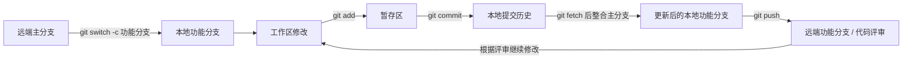

# Git：让变更可追踪、可协作、可回退

Git 用提交记录保存文件变更。分支让多个任务并行开发，合并让变更进入共享历史，提交提供可审阅和可回退的快照。

~~~sh
# 查看当前分支和有未提交修改的文件。
git status --short --branch

# 查看工作区的具体差异，提交前核对内容。
git diff

# 查看最近提交历史，了解改动上下文。
git log --oneline -10
~~~

**解决的问题：** 多人修改同一代码库时，记录变更来源、比较差异并协调合并。

**取舍：** 分支和提交历史提升可追踪性；强制重置或清理命令可能丢弃未提交工作。操作前先看 status 和 diff，特别要保留已存在的本地改动。

**前端排查映射：** “我本地正常、同事分支异常”时先比较提交、未提交改动和环境配置，不要马上归因于浏览器缓存。

## Git 的三个区域和常用命令

```text
工作区 working tree -> 暂存区 index -> 本地仓库 commits -> 远端仓库
       git add              git commit          git push
```

工作区是正在编辑的文件；暂存区决定下一次提交包含哪些内容；本地仓库存放提交历史。`git add` 不等于提交，`git commit` 也不会自动发送到远端。理解这几个状态可以避免把未检查的生成文件、配置或其他任务的改动一起提交。

```sh
# 查看分支、暂存区和工作区状态，先确认当前要操作的位置。
git status --short --branch

# 比较工作区与最近一次提交的差异，不包含已暂存修改。
git diff

# 比较暂存区与最近一次提交的差异，确认下一次提交的实际内容。
git diff --cached

# 交互式选择文件的部分改动进入暂存区，适合一个文件含多个任务时拆分提交。
git add -p path/to/file

# 查询远端分支更新但不自动合并，先了解主分支发生了什么。
git fetch origin

# 只在当前分支没有分叉时快进更新，避免意外创建合并提交。
git pull --ff-only
```

`git pull` 通常相当于 fetch 再执行 merge 或 rebase，具体取决于配置；团队协作时先约定整合方式。`git fetch` 只更新本地看到的远端引用，不会改写当前文件，适合先检查再决定如何合并。

## 一次安全的分支协作流程

```sh
# 创建自己的功能分支，避免直接在共享主分支上混合多个任务。
git switch -c feature/order-filter

# 修改后先检查文件状态和空白错误。
git status --short
git diff --check

# 只把本次任务的文件放进暂存区，并在提交前查看实际暂存内容。
git add path/to/changed-file
git diff --cached

# 提交后同步远端，再将共享主分支的新提交整合到自己的分支。
git commit -m "feat: add order filter"
git fetch origin
git rebase origin/main
```

`rebase` 会重写当前分支上尚未共享的提交；团队若约定 merge，应遵循团队流程。发生冲突时先看 `git status`，解决后逐个暂存冲突文件，再执行 `git rebase --continue`；想放弃本次 rebase 可执行 `git rebase --abort`。不要对其他人已经基于其工作的共享分支强行改写历史。

下面的图把一次日常协作拆成工作区、暂存区、本地提交和远端共享几个状态。它帮助你判断“改动现在在哪里”以及下一步命令会影响哪一份内容；`fetch` 只更新远端跟踪信息，不会自动改变工作区。



合并冲突表示双方都修改了同一片文本，Git 无法判断最终内容。解决时阅读双方修改的业务意图，运行相应测试，再用 `git diff --check` 和 `git diff --cached` 检查结果；不要机械地选“ours”或“theirs”。`git stash` 可临时保存尚未提交的工作，但切换分支前仍应先看状态；stash pop 也可能冲突，不能当作长期备份。

## 撤销操作：先分清工作区、提交和共享历史

| 目标 | 常用方式 | 影响 |
|---|---|---|
| 放弃某个文件尚未暂存的修改 | `git restore -- path` | 丢弃该文件工作区修改，执行前确认内容不需要 |
| 从暂存区移除文件但保留修改 | `git restore --staged -- path` | 文件回到未暂存状态 |
| 撤销已提交且可能已共享的变更 | `git revert <commit>` | 新增一个反向提交，不改写已有共享历史 |
| 移动本地分支指针或丢弃提交 | `git reset` | 可能使提交和工作区内容难以找回，先确认状态并备份 |

多人协作中通常优先用 `revert` 撤销共享提交。`reset --hard`、`clean -fd` 等会直接丢弃内容的命令不应作为冲突处理的第一步。

## Git 常用命令速查

下面按日常任务整理命令。路径、分支名和提交号都要替换成当前仓库里的实际值；涉及丢弃或改写历史的命令先检查 `status`、`diff`，必要时先备份。

### 查看状态、差异与历史

```sh
# 查看当前分支，以及工作区和暂存区的文件状态；?? 表示未跟踪文件。
git status --short --branch

# 查看尚未暂存的文本差异，提交前确认具体改了什么。
git diff

# 查看已经暂存、下一次提交将包含的差异。
git diff --cached

# 检查补丁中的空白错误，例如行尾多余空格。
git diff --check

# 查看最近 20 条精简提交记录，快速确认代码来自哪个提交。
git log --oneline --decorate -20

# 查看某个文件逐行由哪些提交修改，排查行为变化时定位上下文。
git blame -- path/to/file

# 查看两个分支之间的提交差异；三点写法关注从共同祖先到当前分支的提交。
git log --oneline origin/main...HEAD
```

**使用场景：** 提交前用 `status`、`diff`、`diff --cached` 三步确认文件、工作区变化和暂存内容；线上缺陷需要追溯时，用 `log` 找相关提交，再用 `blame` 读取对应行的变更来源。`git diff` 对二进制文件通常无法展示可读内容，生成文件也应先确认是否需要纳入版本控制。

### 分支、远端与提交同步

```sh
# 列出本地分支，并标记当前分支。
git branch --list

# 同时列出本地与远端跟踪分支，观察远端是否有新分支。
git branch --all

# 创建并切换到功能分支；适合开始一个独立需求或修复任务。
git switch -c feature/order-filter

# 切换到已经存在的本地分支；切换前确认工作区修改能安全保留。
git switch feature/order-filter

# 只更新远端引用，不自动合并到当前分支；更新后可先检查远端提交。
git fetch origin

# 查看当前分支跟踪的远端以及领先、落后提交数量。
git status --short --branch

# 将当前分支推送到 origin，并设置上游，后续可直接使用 git push。
git push --set-upstream origin feature/order-filter

# 在当前分支没有分叉时快进合并远端 main，避免生成额外合并提交。
git pull --ff-only origin main
```

**使用场景：** 开新任务先创建分支；准备提测前先 `fetch`，再根据团队约定使用 rebase 或 merge 整合主分支。`git pull` 会把获取远端和整合变更合并为一步，初学者可先 `fetch`、检查提交范围，再明确选择整合方式。不要在未确认团队规则时对已共享分支执行会重写历史的 rebase。

### 暂存、提交与查找内容

```sh
# 暂存某个文件，避免把其他文件或其他任务的修改一起提交。
git add path/to/file

# 交互式选择文件中的代码块暂存；适合一个文件包含多个无关改动。
git add --patch path/to/file

# 提交已经检查过的暂存内容；提交信息说明变更目的。
git commit -m "fix: handle empty order list"

# 修改最近一次本地提交的信息；只适合尚未共享且确认可改写的提交。
git commit --amend -m "fix: handle empty order list"

# 查找提交说明中包含关键字的提交，例如定位某个接口改造。
git log --all --oneline --grep="order filter"

# 搜索所有受 Git 跟踪文件中的文本，定位配置键或方法名。
git grep "spring.datasource.url"

# 查看指定提交修改了哪些文件和内容，核对变更影响范围。
git show --stat <commit>
git show <commit> -- path/to/file
```

`git commit --amend` 会生成新的提交对象；如果旧提交已经推送，其他人可能仍基于旧提交开发，不能直接 amend 后强推。`git grep` 默认只搜索 Git 跟踪文件，未跟踪文件可用编辑器或系统搜索工具查找。

### 暂存临时工作、撤销与恢复

```sh
# 保存已跟踪文件的临时修改，并附上说明；切换分支前避免混入其他任务。
git stash push -m "wip: order filter"

# 同时把未跟踪文件放入 stash；确认其中没有需要永久保留的临时文件。
git stash push --include-untracked -m "wip: include local test"

# 列出暂存记录，挑选要恢复的那一项。
git stash list

# 恢复指定 stash，同时保留 stash 记录，确认结果后再决定是否删除。
git stash apply stash@{0}

# 放弃单个文件尚未暂存的工作区修改；该文件修改会丢失，执行前先看 diff。
git restore -- path/to/file

# 把文件从暂存区移出，但保留工作区内容，适合误暂存后的修正。
git restore --staged -- path/to/file

# 为已经共享的错误提交创建反向提交，保留公开历史的可追踪性。
git revert <commit>
```

**风险边界：** stash 是临时工作区，不是可靠备份；`stash apply` 可能产生冲突。恢复单文件前应确认该文件里没有其他任务的改动。撤销共享变更优先考虑 `revert`；只有确认提交未共享且理解索引区、工作区影响时，才考虑 `reset`。`git clean` 会删除未跟踪文件，使用前先通过 `git clean -n` 预览删除列表。

## 前端开发者的 Git 练习

1. 在自己的分支只修改一个文件，分别观察工作区差异和已暂存差异。
2. 使用交互式暂存把一个文件中的两个不相关改动拆成独立提交。
3. 在本地两个分支修改同一行，练习解决冲突并运行相应测试。
4. 找一个旧提交，比较反向提交与重写历史的差别。

继续学习：[Maven 构建与依赖](./maven.md)、[Docker 镜像与容器](./docker.md)。
