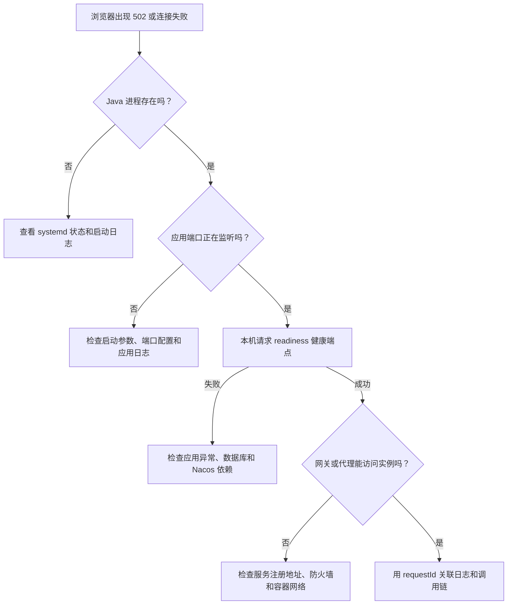

# Linux：进程、服务、日志与主机排错

Linux 是 Java 后端常见的运行环境。本页按进程、端口、依赖、资源和健康状态逐层排查，并介绍部署后的 Java 服务如何运行和发布。

接口不通时，先判断服务进程是否存在、监听哪个端口、磁盘和内存是否正常，再看应用日志和依赖状态。分层检查可避免服务根本没启动时先去调业务代码。

## 从接口异常定位主机故障

下面的流程把“进程存在”“端口监听”“应用就绪”和“依赖可用”分开检查。每一步都能缩小故障范围，避免只凭 `ps` 输出就判断服务正常。



健康端点路径取决于 Spring Boot 与 Actuator 配置；若项目没有 readiness 端点，就按项目实际健康检查替换。图中的“本机健康检查成功”只证明本机端点能响应，仍需验证代理到实例的网络链路。

~~~sh
# 查看当前机器上运行的 Java 进程和启动参数摘要。
ps -ef | grep '[j]ava'

# 查看 TCP 监听端口；根据系统版本也可能需要使用 netstat。
ss -lntp

# 查看内存和文件系统空间。
free -h
df -h

# 查看某个目录增长情况；先确认路径，再对大目录做深入扫描。
du -sh /var/log/backend

# 查看进程当前打开的文件和 socket 数量，排查文件描述符耗尽。
PID=1234
ls "/proc/${PID}/fd" | wc -l

# 查看 inode 使用率；容量未满但 inode 用尽时也无法创建新文件。
df -i

# 查看当前 shell 的文件描述符上限；服务进程限制还可能来自 systemd 或容器配置。
ulimit -n

# 用 HTTP 健康端点验证本机应用是否实际返回响应，而不只看进程存在。
curl --max-time 5 -i http://127.0.0.1:8080/actuator/health/readiness

# 读取服务日志最后 200 行以发现启动或请求异常。
tail -n 200 /path/to/service.log

# 如果服务由 systemd 管理，查看服务状态和最近日志。
systemctl status backend.service
journalctl -u backend.service -n 200 --no-pager
~~~

排查顺序：服务进程是否反复退出；监听端口是否匹配网关配置；启动日志是否出现配置中心或数据库失败；资源是否耗尽；到 Nacos、数据库和 Redis 的网络是否可达；网关能否发现实例。

**前端排查映射：** Network 中出现连接拒绝或 502 时，先看监听和注册状态。Controller 断点没命中并不必然是断点错误，请求可能还没到业务服务。

`ps` 的启动参数可能包含配置值，分享终端输出前要检查是否泄露密钥。systemd 服务日志通过 journald 管理；容器日志通常由容器运行时或平台采集，不能假设它们都写入同一个 `.log` 文件。

## Linux 常用命令速查

命令因发行版、权限和安装的软件包略有差异。先使用普通用户可执行的只读命令收集证据；需要 `sudo` 的操作应确认目标主机和变更范围。不要为了“先试试”对 `/` 或整个应用目录递归修改权限。

### 文件、目录与文本日志

```sh
# 查看当前目录，确认相对路径命令会作用在哪个位置。
pwd

# 列出文件详情，包括隐藏文件、权限、属主、大小和修改时间。
ls -lah /opt/backend

# 查看单个文件的权限、属主、大小和修改时间，便于排查配置不可读。
stat /etc/backend/application.yml

# 只读查看文件开头，适合检查配置文件或日志的格式。
head -n 40 /etc/backend/application.yml

# 查看文件最后 200 行，先从最新错误附近定位问题。
tail -n 200 /var/log/backend/application.log

# 持续跟随日志追加内容；Ctrl+C 结束跟随，不会停止写日志的服务。
tail -n 100 -f /var/log/backend/application.log

# 在指定日志中搜索异常关键词并显示行号；对很大的日志可先限定最近时间范围或拆分文件。
grep -n -E 'ERROR|Exception|Caused by' /var/log/backend/application.log

# 查找目录下名称匹配的配置文件；使用已知目录缩小范围，避免扫描整个磁盘。
find /etc/backend -type f -name '*.yml' -print
```

使用 `less /path/to/file` 可以交互翻阅大文件（按 `q` 退出）；日志搜索结果要结合时间戳、请求 ID 和完整异常链阅读。配置文件中可能包含凭据，终端截图或工单附件应先脱敏。

### 进程、CPU、内存和端口

```sh
# 按 CPU 和内存用量交互查看进程；按 q 退出，不会改变进程状态。
top

# 根据服务名查 PID；-a 显示完整命令行时要注意其中可能有敏感启动参数。
pgrep -a -f 'app.jar'

# 查看进程树，确认 Java 服务由谁启动以及是否有子进程。
pstree -ap 1234

# 查看进程状态、CPU/内存占用和启动命令摘要；将 1234 替换为实际 PID。
ps -p 1234 -o pid,ppid,user,stat,%cpu,%mem,etime,cmd

# 查看 TCP/UDP 监听端口及进程名；权限不足时部分 PID 信息可能不显示。
sudo ss -lntup

# 检查指定 TCP 端口是否处于监听状态；输出中的 Local Address:Port 是实际监听地址。
sudo ss -lntp 'sport = :8080'

# 对本机 HTTP 服务发起有超时限制的请求，-i 同时显示响应状态和 Header。
curl --max-time 5 -i http://127.0.0.1:8080/actuator/health/readiness

# 测试目标主机的 TCP 端口连通性；-v 显示连接阶段，-z 不发送应用数据。
nc -vz -w 3 db.internal.example.test 3306
```

`ss` 显示 `127.0.0.1:8080` 表示仅本机可连；`0.0.0.0:8080` 表示监听所有 IPv4 网卡，但能否从外部访问还取决于防火墙、云安全组和路由。`curl` 本机成功只证明本机到服务的路径可用，不证明外部入口、认证或业务调用成功。

### 磁盘、内存与资源限制

```sh
# 按易读单位查看各挂载文件系统的总量、已用、可用和使用率。
df -h

# 检查 inode 是否耗尽；磁盘仍有空间时 inode 也可能先用完。
df -i

# 汇总指定目录的空间占用；先从应用日志、上传和临时目录等已知路径开始。
sudo du -sh /var/log/backend /var/lib/backend /tmp

# 按大小列出指定目录的一层子目录，快速找出增长较快的位置。
sudo du -xhd 1 /var/log 2>/dev/null | sort -h

# 查看内存和 swap 总量、已用量；Linux 会用部分空闲内存做缓存，需结合 available 判断。
free -h

# 每秒观察 CPU、运行队列、内存和 I/O 汇总；按 Ctrl+C 结束。
vmstat 1

# 检查当前 shell 的文件描述符上限；服务进程限制还应检查 systemd 和容器配置。
ulimit -n

# 查看 PID 对应的文件描述符数量；描述符持续增长可能提示泄漏。
ls /proc/1234/fd | wc -l
```

发现大文件后先确认归属、是否仍被进程打开以及是否有集中式日志副本。直接删除在线日志文件未必释放空间，进程可能仍持有已删除文件的句柄；应按日志轮转策略处理，并验证磁盘空间确实释放。不要用 `rm -rf` 或清空数据目录作为常规排错步骤。

### 服务状态与日志

```sh
# 查看服务当前状态、主进程 PID、最近退出码和失败摘要。
systemctl status backend.service --no-pager

# 显示 unit 文件合并后的内容，检查实际 ExecStart、用户和环境文件路径。
systemctl cat backend.service

# 查看最近 200 行服务日志，不导出整机所有日志。
journalctl -u backend.service -n 200 --no-pager

# 按时间缩小日志范围，定位最近半小时内的启动或请求错误。
journalctl -u backend.service --since '30 minutes ago' --no-pager

# 持续查看新日志；Ctrl+C 只退出查看，不会停止服务。
journalctl -u backend.service -f

# 查看服务是否启用开机启动；enabled 表示配置了开机启动，不等同于当前正在运行。
systemctl is-enabled backend.service
```

`systemctl status` 中的 `Active` 描述服务管理状态；仍要用端口监听和就绪端点确认服务是否能接收流量。服务若反复重启，结合 `Restart` 策略、退出码和最早的启动异常定位原因，单纯手工重启可能掩盖故障。

### 会改变运行状态的 systemd 命令

以下命令会影响目标主机或服务。确认服务名、变更窗口和回滚方案后再执行；学习时在本地虚拟机或测试环境演练。

```sh
# 修改 unit 文件后让 systemd 重新读取定义；这不会自动重启正在运行的应用。
sudo systemctl daemon-reload

# 启动服务，会创建或恢复应用进程。
sudo systemctl start backend.service

# 停止服务，会中断新请求；应用应先从流量入口摘除并优雅结束在途请求。
sudo systemctl stop backend.service

# 重启服务会造成短暂中断；只有确认发布策略允许时才执行。
sudo systemctl restart backend.service

# 设置系统启动时自动启动；修改的是服务启用状态。
sudo systemctl enable backend.service
```

修改服务单元后通常先 `daemon-reload`，再根据部署方案执行 reload 或 restart；二者不能混为一谈：reload 请求应用重新载入配置（前提是服务支持），restart 会重新创建进程。操作后用 `systemctl status`、`ss` 和健康端点逐层验收。

## 用 systemd 管理长期运行的 Java 服务

systemd 负责进程启动顺序、退出后的重启策略、开机启动和日志入口。不要用 SSH 会话里的后台命令长期托管生产服务；终端断开后，进程生命周期和日志收集可能失去管理。

```ini
# /etc/systemd/system/backend.service：最小服务单元示例，路径与用户按部署环境调整。
[Unit]
# 给管理员和日志使用的服务说明。
Description=Backend API Service
# 等网络配置完成后再启动；这不代表数据库或 Nacos 已就绪。
After=network-online.target
# 请求 systemd 拉起网络在线目标。
Wants=network-online.target

[Service]
# 使用专用低权限账号运行 Java 进程。
User=backend
# 设置应用工作目录，供相对路径和日志配置使用。
WorkingDirectory=/opt/backend
# 从外部文件加载非秘密运行配置；生产密钥优先使用受控 Secret 机制。
EnvironmentFile=/etc/backend/backend.env
# 直接运行 Java 进程，确保 systemd 能正确跟踪 PID 和停止信号。
ExecStart=/usr/bin/java -jar /opt/backend/app.jar
# 只在异常退出时重启，避免正常停止后被反复拉起。
Restart=on-failure
# 进程异常退出后等待几秒再重试，避免紧密重启循环。
RestartSec=3
# 给应用处理 SIGTERM 和完成在途请求的最长时间。
TimeoutStopSec=30

[Install]
# 允许服务配置为系统多用户运行级别启动。
WantedBy=multi-user.target
```

部署单元文件变更后，运维人员需要让 systemd 重新读取配置，再按变更流程重载或重启目标服务。只读排查时常用命令如下：

```sh
# 检查 systemd 解析后的服务定义，确认实际 JAR 路径与环境文件。
systemctl cat backend.service

# 查看服务状态、最近退出码和启动失败摘要。
systemctl status backend.service --no-pager

# 按时间查看服务日志，避免直接导出整机所有日志。
journalctl -u backend.service --since "30 minutes ago" --no-pager

# 持续跟随该服务新日志，复现请求时观察启动与错误信息。
journalctl -u backend.service -f
```

```sh
# 仅在服务单元已评审且目标环境变更获批后，让 systemd 重新读取 unit 文件。
sudo systemctl daemon-reload

# 仅按部署窗口和回滚方案重启服务；之后检查状态、端口和就绪探针。
sudo systemctl restart backend.service
```

服务账户、工作目录、端口和配置文件权限需要一起检查。Java 进程存在但没有监听端口，可能仍在启动、卡在依赖连接或启动失败后自动重启；结合启动日志和健康检查才能判定。

## 主机上的启动与部署验收

CI/CD 流程、同一制品晋级、灰度策略和发布回滚的主说明见 [CI/CD 与可靠发布](./cicd.md)。本页聚焦 Linux 主机上的服务进程、systemd、端口、日志、资源和停止行为，帮助你验证制品部署后是否真正可运行。

主机侧验收仍要区分进程启动、端口监听、探针就绪和业务请求成功；某一步成功不能证明后续步骤已完成。部署记录应注明版本、目标环境、启动结果和关联的流水线记录。

### 存活、就绪与启动检查

| 检查 | 要回答的问题 | 失败时通常的处理 | 设计注意 |
|---|---|---|---|
| Startup | 应用是否还在初始化，是否需要更长启动窗口 | 暂缓后续存活判定 | 适合启动慢、加载大量配置的服务 |
| Liveness | 进程是否卡死或已无法继续服务 | 编排平台可能重启实例 | 不要简单把数据库短暂不可用算作进程死亡，否则会形成重启风暴 |
| Readiness | 当前实例是否可以接收新流量 | 暂时从负载均衡摘除 | 可检查关键本地初始化；依赖检查需避免把全站短暂故障扩大成所有实例离线 |

健康检查端点应避免泄露数据库地址、账号或内部拓扑。浏览器请求的 `/health` 返回 200 只证明该端点响应；还要核实检查类型、编排平台如何使用结果，以及真实业务路径是否成功。

### 优雅停机

容器或进程收到停止信号后，服务应停止接收新流量，等待正在处理的请求在限定时间内结束，停止领取新消息并提交或释放当前任务，最后关闭线程池和连接池。等待时间要小于平台的强制终止期限；超时后仍要保证任务可重试或幂等恢复。

发布策略、旧新版本兼容和回滚证据见 [CI/CD 与可靠发布](./cicd.md)；Linux 侧重点是确认目标 systemd 单元收到了信号、停止期限生效、端口释放且进程退出码符合预期。

## Linux 与部署练习

1. 在开发环境记录一个 Java 服务的 PID、监听端口、运行用户和日志位置。
2. 对照 systemd unit 的运行用户、工作目录、启动命令和停止期限，解释每项如何影响服务。
3. 查看健康检查状态，区分进程存在、端口监听和实例可接收流量。
4. 在测试环境执行一次受控停止，记录 systemd 状态变化、服务退出码、端口释放时间和日志中的优雅关闭步骤。

继续学习：[Nginx 反向代理](./nginx.md)、[Docker 容器](./docker.md)、[微服务与消息系统](./distributed.md)。
