# Maven：管理 Java 依赖和构建生命周期

Maven 使用 pom.xml 描述项目坐标、依赖、插件和模块。依赖通过坐标定位；父 POM 可统一管理版本；聚合 POM 可一次构建多个子模块。

- 生命周期定义编译、测试、打包执行顺序。
- 依赖树显示某个类来自哪个库以及传递依赖来源。
- 模块依赖定义构建业务模块前需要哪些项目内模块。
- Profile 可切换构建参数；运行时环境配置仍要单独验证。

## 依赖、版本管理与 scope

`<dependencies>` 表示当前模块实际需要该依赖；`<dependencyManagement>` 只管理子模块可继承的版本和默认配置，本身不会把依赖加入 classpath。父 POM 既可以提供继承配置，也可以通过 `<modules>` 聚合子模块；“继承关系”和“聚合构建”是两个不同概念。

| scope | 编译主代码 | 测试代码 | 典型用途 |
|---|---|---|---|
| `compile`（默认） | 是 | 是 | 应用运行所需的常规依赖 |
| `provided` | 是 | 是 | 运行环境提供的 API，例如某些 Servlet 容器 |
| `runtime` | 否 | 是 | 编译时不直接调用、运行时需要的驱动或实现 |
| `test` | 否 | 是 | JUnit、测试替身等测试专用依赖 |

依赖还可能通过其他依赖传递进来。Maven 按依赖树和版本仲裁规则选择版本；编译错误中的类可能来自传递依赖，而不是你当前 POM 里显式写出的项。`optional` 依赖默认不继续传递给使用者；`exclusions` 可以移除不需要的传递依赖，但应先确认删除后没有其他模块仍需要它。

父 POM 的 `<dependencyManagement>` 常用于统一 Spring Boot、Spring Cloud 等 BOM 的版本。导入 BOM 的典型写法如下，子模块仍要在 `<dependencies>` 中声明自己真正使用的组件：

```xml
<!-- 仅统一依赖版本，不会自动把 BOM 中所有组件添加到当前模块。 -->
<dependencyManagement>
    <dependencies>
        <!-- 使用经过验证的 BOM 版本集中管理相关依赖。 -->
        <dependency>
            <groupId>org.example</groupId>
            <artifactId>example-bom</artifactId>
            <version>1.2.3</version>
            <type>pom</type>
            <scope>import</scope>
        </dependency>
    </dependencies>
</dependencyManagement>
```

出现“IDE 能编译、打包后找不到类”时，核对 scope 和最终镜像中的 JAR；出现版本冲突时看依赖树，而不是只看当前模块的 POM。

~~~sh
# 构建仪表盘模块，并一并构建它依赖的项目内模块。
mvn -pl gykj-modules/gykj-dashboard -am -DskipTests package

# 运行目标模块测试；测试说明会指出是否需要数据库等外部服务。
mvn -pl gykj-modules/gykj-dashboard test

# 查看依赖版本由哪条依赖路径引入。
mvn -pl gykj-modules/gykj-dashboard dependency:tree

# 查看指定依赖及其引入路径，缩小冲突排查范围。
mvn -pl gykj-modules/gykj-dashboard dependency:tree -Dincludes=org.example:example-library
~~~

常见生命周期依次包括 `validate`、`compile`、`test`、`package`、`verify`、`install` 和 `deploy`。`install` 把产物写入本机 Maven 仓库；`deploy` 会发布到配置的远端仓库。`-DskipTests` 通常仍编译测试代码但跳过执行；`-Dmaven.test.skip=true` 还会跳过测试编译，不能把这两种情况描述成测试通过。

下图说明 Maven 生命周期命令为什么会依次经过前面的阶段，以及最终产物分别去哪里。构建在任一阶段失败都会停止后续阶段；执行 `mvn verify` 不会自动发布到远端仓库，只有执行 `deploy` 才会进入发布阶段。

```mermaid
flowchart LR
  %% 校验项目结构和必须的属性，发现配置错误时后续阶段不会运行。
  A[validate 校验项目] --> B[compile 编译主代码]
  %% 测试代码先编译，再运行绑定到 test 阶段的测试。
  B --> C[test 编译并运行测试]
  %% package 生成 JAR 或 WAR 等项目产物。
  C --> D[package 生成产物]
  %% verify 执行绑定在验证阶段的检查，但不等同于部署。
  D --> E[verify 集成与质量检查]
  %% install 将产物放入开发者本机 Maven 仓库，供其他本地模块使用。
  E --> F[install 安装到本地仓库]
  %% deploy 将产物发布到 POM/settings 配置的远端仓库。
  F --> G[deploy 发布到远端仓库]
```



执行某个生命周期阶段时，Maven 会按顺序执行之前的阶段。例如 `mvn verify` 会先编译、测试、打包，再执行绑定到 `verify` 的检查；具体插件是否绑定由 POM 决定。多模块仓库可用 `-pl` 选择模块、`-am` 同时构建它依赖的兄弟模块。团队若提供 Maven Wrapper，应优先使用仓库中的 `./mvnw`（Windows 为 `mvnw.cmd`），避免本机 Maven 版本不同造成构建差异。

排错时先读失败的 lifecycle phase 和第一个根因异常，再区分依赖下载失败、Java 版本不兼容、编译错误、测试失败或打包插件失败。`-e` 可展开异常链；`-X` 会输出大量配置和环境信息，分享前要检查是否包含内部地址或凭据。

Maven Profile 是构建时选择的 POM 配置；Spring Profile 通常是应用启动时选择的运行配置。打包参数能改变依赖或资源，并不意味着目标服务器自动拿到了正确的数据库、Redis 或配置中心地址。认证信息仍应由部署环境的 Secret 注入。

构建 Profile 可通过 `-Pdev` 等方式选择，也可能由操作系统或属性自动激活。Profile 适合切换构建插件、打包资源和测试参数；不应通过构建时 Profile 把生产口令烘焙进 JAR。部署运行时要核实实际的 `spring.profiles.active`、外部配置和 Secret 注入结果。

**解决的问题：** 统一管理 Java 编译、依赖、测试和产物打包，避免手工拼 classpath。

**取舍：** 父 POM、插件和 Profile 会带来间接配置。构建成功只说明构建/测试命令完成，不代表数据库迁移、服务部署或目标环境验收成功。依赖冲突要查看 dependency tree，避免随意在子模块硬编码另一个版本。

## 常见构建问题的定位顺序

1. 先看失败的模块和 lifecycle phase，不要只看日志末尾的 BUILD FAILURE。
2. 找到第一条根因异常，区分依赖下载、编译错误、测试失败和插件错误。
3. 遇到缺类或版本冲突，运行 dependency tree 检查传递路径和 scope。
4. 多模块构建失败时，用模块选择参数明确目标，并一并构建项目内依赖。
5. 比较 Maven/JDK 版本和构建 Profile，确认没有把运行环境配置误当成构建配置。
6. 修复后运行 verify 或项目要求的测试命令，再检查最终 JAR/镜像是否包含预期产物。

## Maven 常用命令速查

优先使用仓库自带的 Maven Wrapper：macOS/Linux 通常运行 `./mvnw`，Windows PowerShell 运行 `.\mvnw.cmd`。Wrapper 会按项目配置使用 Maven 版本；如果仓库没有 Wrapper，再使用本机 `mvn`。以下命令都应在含有 `pom.xml` 的目录运行，涉及多模块时先确认当前目录是父 POM 还是子模块。

### 编译、测试与打包

```sh
# 清理 target 等上次构建生成的文件，然后编译主代码。
mvn clean compile

# 执行单元测试；测试需要的数据库、Redis 等服务也必须满足测试环境配置。
mvn test

# 执行单个测试类，缩短定位失败测试的反馈时间。
mvn -Dtest=OrderServiceTest test

# 执行指定测试方法；适合只重跑刚修改的行为。
mvn -Dtest=OrderServiceTest#shouldReturnEmptyWhenNoOrders test

# 打包 JAR，并执行绑定到 package 阶段及之前的生命周期任务。
mvn clean package

# 执行 verify 阶段；适合运行项目绑定的集成检查和质量校验。
mvn clean verify

# 跳过测试执行但仍编译测试源码；仅在快速验证打包流程时使用。
mvn -DskipTests package

# 连测试源码编译也跳过；应清楚这是跳过测试，不是测试通过。
mvn -Dmaven.test.skip=true package
```

`clean` 会删除当前模块的构建输出目录（通常是 `target`），不会删除源代码；但若项目把重要文件错误地放进生成目录，这些文件也会被清掉。`package` 成功只证明当前构建阶段完成，发布前应按项目要求运行测试和 `verify`。不要在 CI 或发布验收中把跳过测试的结果当成测试通过。

### 多模块项目与依赖排查

```sh
# 只构建指定模块；路径通常相对于当前聚合 POM，模块名也可按项目配置使用。
mvn -pl gykj-modules/gykj-dashboard package

# 同时构建指定模块依赖的兄弟模块，避免本地仓库缺少最新模块产物。
mvn -pl gykj-modules/gykj-dashboard -am package

# 同时构建依赖此模块的兄弟模块；适合检查改动对下游模块的影响。
mvn -pl gykj-modules/gykj-common -amd verify

# 展开当前模块依赖树，查看依赖从哪里传递引入以及最终仲裁版本。
mvn dependency:tree

# 只查看指定 groupId/artifactId，缩小版本冲突的排查范围。
mvn dependency:tree -Dincludes=org.example:example-library

# 导出当前模块的有效 POM，检查父 POM、属性和 Profile 合并后的配置。
mvn help:effective-pom -Doutput=target/effective-pom.xml

# 查看实际激活的 Maven Profile，排查构建参数与预期不一致。
mvn help:active-profiles
```

`-pl` 选择项目列表，`-am` 同时构建所选模块依赖的项目，`-amd` 同时构建依赖所选模块的项目。模块路径因仓库而异，先从父 POM 的 `<modules>` 或 `mvn -pl :artifactId -am validate` 确认。依赖树显示的是构建解析结果；要确认运行时最终装入了什么，还需结合打包插件和 JAR 内容检查。

### Profile、仓库与构建诊断

```sh
# 激活名为 dev 的 Maven Profile；它改变构建配置，不等于启动 Spring dev 环境。
mvn -Pdev clean package

# 同时激活两个 Maven Profile，逗号分隔名称。
mvn -Pdev,with-it package

# 离线构建，只使用本机 Maven 仓库已有依赖；缺少缓存依赖时会失败。
mvn -o package

# 强制检查远程更新，排查 SNAPSHOT 或本机缓存导致的依赖版本陈旧。
mvn -U clean verify

# 展开异常堆栈，定位第一个根因异常和调用链。
mvn -e test

# 输出 Maven 插件和依赖解析的详细调试日志；日志可能包含内部路径或配置值。
mvn -X package

# 指定 settings 文件，适合使用团队提供的仓库镜像配置。
mvn -s ./settings.xml -DskipTests package
```

`-P` 激活 Maven 构建 Profile，`-Dname=value` 设置 Maven 属性或传给插件的参数；两者都不等同于 Spring Boot 的 `spring.profiles.active`。`-U` 会检查远端更新，不会修复远端仓库不可用；`-o` 只能使用本机已有依赖。分享 `-X` 输出或有效 POM 前，先检查私服地址、用户名、令牌和内部目录等敏感信息。仓库凭据应由 `settings.xml`、环境变量或 CI Secret 注入，不要提交到项目 POM。

### 运行打包产物

```sh
# 启动 Spring Boot 可执行 JAR，并在运行时选择 dev 配置；路径按实际产物修改。
java -jar target/application.jar --spring.profiles.active=dev
```

在 Windows PowerShell 中可用 `Get-ChildItem .\target\*.jar` 查看打包产物。
打包后仍要确认这是可执行 Spring Boot JAR、配置从正确位置加载，且目标数据库和服务可连接。Maven 的 `-Pdev` 在构建时生效，`--spring.profiles.active=dev` 在应用运行时生效；两种 Profile 可以同名，但用途和读取时机不同。

## 前端开发者的 Maven 练习

- 从一个 Controller 所在模块找到它的父 POM，画出父子继承和聚合模块关系。
- 用依赖树找出 Web 框架、数据库驱动和测试依赖分别从哪里引入。
- 对比跳过测试执行、跳过测试编译和正常 verify 的结果。
- 找到构建 Profile 与 Spring Runtime Profile，记录它们各自在什么时候生效。

继续学习：[Git 协作与版本控制](./git.md)、[Docker 镜像与容器](./docker.md)、[Linux 与服务运行](./linux.md)。
