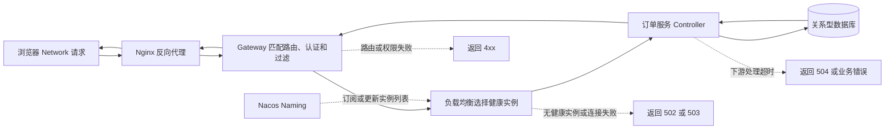

# Gateway、Sentinel、Seata 与 API 工具

微服务工具把跨服务的入口、流量保护、事务协调、接口验证和运行观测变成可配置的能力。工具本身不会自动让业务正确：要知道它负责哪一段、依赖哪些配置、失败时怎样表现，并用运行日志和请求结果确认它真的生效。

本页集中讲具体工具的配置入口、常用命令和故障排查；服务边界、超时预算、重试、消息幂等、Outbox 和 Saga 的通用设计见[微服务与消息系统](./distributed.md)。

## 工具地图

| 工具/组件 | 解决的问题 | 前端可观察到的结果 |
|---|---|---|
| Spring Cloud Gateway | 统一外部 API 入口、服务路由和入口过滤 | API URL 前缀、401/403/404/429/502/503 和响应 Header |
| Sentinel | 按规则限流、熔断和提供受控降级 | 429/自定义 fallback、部分接口变慢或短暂不可用 |
| Seata | 在支持的模式下协调跨服务数据库事务 | 状态短暂等待、全局事务回滚或补偿失败 |
| Swagger / Knife4j | 浏览服务端生成的接口契约 | 字段、必填项、枚举和响应结构可视化 |
| Apifox / Postman | 保存请求、环境和联调场景 | 可复现浏览器以外的接口行为 |
| Actuator、Prometheus、Grafana、Trace 系统 | 查看健康、指标和跨服务调用链 | 能把 Network 的耗时映射到服务、线程池、下游和数据库 |

这些工具的版本、配置持久化和部署方式会随项目变化。依赖出现在 POM 中只证明声明过依赖；还要检查自动配置条件、Profile、启动日志、控制台状态和实际流量。

## Spring Cloud Gateway：从浏览器入口路由到服务

### 请求经过哪些步骤

Gateway 接收外部 URL 后，通常按 Route Predicate 匹配路由，再依次执行过滤器、解析服务名/选择实例、转发请求和处理响应。全局过滤器可能参与认证、requestId、限流、CORS 或日志；路径过滤器可能改写 URL。

```text
浏览器请求 /api/orders/123
  -> Nginx 转发至 Gateway
  -> Gateway 按域名/Path/Method 匹配 Route
  -> StripPrefix 或 RewritePath 改写路径
  -> lb://order-service 解析健康实例
  -> 下游 Controller 接收实际路径
  -> 响应沿原链路返回浏览器
```

下面的图补上 Nacos、业务服务和数据库之间的关系。Nacos 提供服务实例列表；实例通常由 Gateway 客户端订阅并缓存，处理每次 HTTP 请求时不一定同步调用 Nacos。



排错时按箭头逐段核对请求路径和状态码：浏览器看到 404 可能由 Nginx、Gateway 或 Controller 任一层返回；服务列表存在实例也不保证实例端口可从 Gateway 网络访问。

### 排查一条 Gateway 路由

1. 从浏览器 Network 记录完整 URL、方法、Header 和状态码。
2. 找 Nginx `proxy_pass`，计算转发后 Gateway 实际看到的路径。
3. 找 Route 的 Predicate 顺序和路径过滤器，写出过滤前/后的路径。
4. 检查 `lb://service-name` 与服务注册的 Service、namespace 和 group 是否一致。
5. 对比下游 Controller 映射和 Gateway 上游日志，确认 404/502 是哪一跳产生。
6. 检查认证、CORS 和限流过滤器是否只在预期入口执行。

```yaml
spring:
  cloud:
    gateway:
      routes:
        - id: order-route
          # 使用服务发现的逻辑名，不固定写某一台实例 IP。
          uri: lb://order-service
          predicates:
            # 只匹配订单 API 的外部路径；顺序和范围要与其他路由一起检查。
            - Path=/api/orders/**
          filters:
            # 删除最前面的 /api 段；下游实际收到 /orders/**。
            - StripPrefix=1
```

### 常见响应与定位

- **401**：通常是缺失、过期或无效身份凭据；检查 Token 是否带到 Gateway 以及刷新逻辑。
- **403**：身份可能有效，但入口或业务权限不允许；核对角色、租户和资源级权限。
- **404**：Route 未匹配、路径改写结果错误，或下游 Controller 不存在该映射。
- **429**：入口限流或下游限流；查看限额主体、响应体和 `Retry-After`。
- **502/503**：无健康实例、网络连接失败、服务发现不一致或下游主动拒绝。
- **504**：Gateway 等待上游超时；需要继续看下游日志和内部调用耗时。

Gateway 认证不能替代业务服务的权限校验；外部传来的 `X-User-Id` 不应直接当作可信身份。只在 Gateway 使用 CORS 规则时，确认请求确实经过该入口，避免出现浏览器预检由 Nginx 响应、实际请求却到另一处的配置分裂。

## Sentinel：流量保护与熔断降级

Sentinel 在客户端进程内依据规则判断请求是否可通过，并可对流控、熔断和热点参数做保护。Sentinel 控制台用于查看应用和配置/推送规则；控制台本身不是业务请求执行点，客户端规则是否落地由应用依赖、连接配置和规则数据源决定。

### 常见规则分别控制什么

| 规则 | 解决的问题 | 例子 | 取舍 |
|---|---|---|---|
| 流量控制 | 限制资源的请求速率或并发 | 导出接口每用户并发限制 | 拒绝太严会让正常用户看到错误；需按资源和主体设规则 |
| 熔断降级 | 下游慢或错误持续时保护调用方 | 用户画像服务错误率升高时暂时快速失败 | 降级值必须保留“数据不可用”语义，不能伪装成空数据 |
| 热点参数 | 某些参数值集中导致资源倾斜 | 某个热门商品 ID 的访问远高于其他 ID | 参数规则需要识别热点，但不能把高基数参数全部当标签 |
| 系统保护 | 当前实例 CPU、负载或入口并发过高时限制流量 | 高负载时保护线程池 | 依赖准确的系统指标与容量测试，不能替代限流和容量规划 |

### 规则生效与排错

1. 确认服务依赖 Sentinel 客户端并以预期 `app` 名称连接控制台/规则源。
2. 确认规则绑定到 Controller、方法、Feign 调用或自定义资源中的正确资源名。
3. 在测试环境用有控制的请求制造阈值，再查看 Sentinel 控制台统计、应用日志和响应状态。
4. 检查 fallback/BlockHandler 的签名和返回协议；让调用方能区分限流、熔断和“确实没有数据”。
5. 确认规则重启后仍然存在。仅保存在控制台内存的规则可能在控制台或客户端重启后消失，应按版本接入持久化规则源。

Fallback 是业务契约的一部分：下游查询失败时返回空列表会误导前端展示“零条数据”。应返回明确错误码、可重试标志或可识别的降级字段，并在 UI 上显示适当状态。

## Seata：跨服务数据库事务协调

Seata 是一类分布式事务方案，提供 AT、TCC、Saga、XA 等不同模式（具体支持和行为依版本）。它协调的是按模式接入的事务资源，不会让任意 HTTP API、Redis 命令、文件写入和第三方支付自动进入同一个原子事务。

| 模式 | 核心机制 | 常见适用面 | 需要承担的代价 |
|---|---|---|---|
| AT | 解析 SQL、记录前后镜像/回滚日志，协调自动回滚 | 支持的关系型数据库和常规 SQL | SQL 约束、数据源代理、全局锁和 undo log；要验证兼容 SQL 与性能 |
| TCC | Try 预留，Confirm 确认，Cancel 释放 | 可以显式设计预留和释放操作的业务 | 每个参与者实现三个分支，并保证幂等、空回滚和悬挂处理 |
| Saga | 多个本地事务串联，失败执行补偿 | 流程较长、接受最终一致的业务 | 状态机、补偿失败恢复、重试和人工处理 |
| XA | 数据库 XA prepare/commit 两阶段提交 | 数据库资源支持且需要更强原子语义 | 持锁时间、协调器可用性和吞吐压力 |

### 看懂一次 Seata 事务

```text
入口服务创建全局事务并生成 xid
  -> 下游服务收到并传播同一 xid
  -> 各服务开启本地事务并登记分支
  -> 入口业务成功：协调器通知分支提交
  -> 入口业务失败：协调器通知分支回滚
  -> 分支结果上报并由协调器记录全局状态
```

阅读项目时要确认入口是否有全局事务注解/模板、Feign/RPC 是否传播 xid、数据源是否被对应代理包装、事务协调器地址和存储是否配置、业务异常是否触发回滚。只有 POM 依赖而没有上述调用链，不能说明该业务正在使用 Seata。

分布式事务不能替代幂等和监控：网络故障时协调结果可能暂时未知，协调器可能重试分支；要观察全局事务停留时间、分支失败、回滚失败和待补偿记录。涉及微信/支付宝等外部支付时，支付渠道通常不参与本地 Seata 全局事务，应通过商户订单号、渠道交易号、通知验签、幂等处理和对账来处理边界。

## Swagger / Knife4j 与 Apifox / Postman

Swagger 或 Knife4j 从服务端注解生成接口文档，帮助查看 path、方法、请求 DTO、字段校验、响应结构和认证 Header。它解决“后端实际接收什么”不清楚的问题；但文档可能过时、只覆盖当前服务版本，不能代替运行接口验证。生产环境要评估是否暴露敏感内部接口或管理端点。

Apifox/Postman 可保存请求集合和环境变量，便于在没有浏览器页面时重现接口：

1. 建立 dev/test 环境，设置 API base URL 和登录获取的短期 Token 变量。
2. 按照 API 契约填写方法、Query、Path、Body 和 Header，避免把 Token 写入共享集合。
3. 先调用登录或获取凭证接口，再执行需要授权的请求；对比请求头和浏览器 Network。
4. 记录响应 status、业务 code、字段类型、耗时和 requestId，不仅截图成功响应。
5. 将稳定的无凭据请求和断言导入团队集合；私密环境变量单独存储，不提交到 Git。

工具返回 200 但页面失败时，再检查统一响应拦截器、Token 注入、CORS、Gateway 路由和前端字段映射。工具绕过浏览器 CORS，因此“Apifox 成功”不能证明浏览器允许跨域读取。

## Actuator、指标、日志和链路追踪

| 数据类型 | 回答的问题 | 常见例子 | 排错时的边界 |
|---|---|---|---|
| 日志 | 发生了什么、输入和错误上下文是什么 | requestId、业务 ID、异常堆栈 | 需要脱敏；没有统一 ID 时跨服务搜索困难 |
| 指标 | 故障规模、趋势和资源压力多大 | QPS、错误率、P95/P99、线程池和连接池 | 指标标签不能无限高基数，否则监控系统本身会过载 |
| Trace | 一次请求经过哪些服务，每段耗时多少 | Gateway -> order -> profile 的 Span | 采样可能丢掉部分请求；异步消息需传播上下文 |
| Health/Actuator | 实例是否可用、当前暴露了哪些运维状态 | readiness、liveness、应用状态 | 端点要限制访问，不能公开环境变量和敏感详情 |

### 从浏览器耗时找到慢的一跳

1. 在 Network 记录总耗时、请求 ID 和响应码。
2. 用 requestId/traceId 查询 Gateway Trace，找到最长 Span 和错误类型。
3. 查看该服务的下游 HTTP、SQL、Redis 和线程池/连接池等待时间。
4. 对比同时间段的 QPS、P95/P99、错误率、重试量和资源指标。
5. 确认一次部署、配置变更或队列积压是否与故障起点吻合。

如果调用使用 W3C `traceparent` 或项目自定义 Header，要确认 Gateway 和客户端没有删掉它；异步消息要将 Trace 上下文放进消息属性，不能依靠线程本地变量跨进程传播。日志和 Trace 标签不要包含 Token、密码、身份证号等敏感值。

## 常用命令与联调

下面的命令用于本机或经授权的测试环境。先从浏览器 Network 或服务配置中确认真实地址、路径和端口；Actuator、Gateway 管理端点、OpenAPI 文档可能未启用或被改路径，生产环境必须做内网隔离和访问控制。

### 从命令行重放 API 请求

```sh
# 设置本地 Gateway 地址；具体端口和上下文路径以项目配置为准。
GATEWAY_URL='http://127.0.0.1:8080'

# 发起只读 GET 请求并查看 HTTP 响应头和响应体，便于区分 HTTP 状态与业务 code。
curl --include --max-time 10 \
  --header 'Accept: application/json' \
  "$GATEWAY_URL/api/orders/123"

# 在测试环境提交虚构数据；修改操作会写入业务数据，不要对生产环境照抄。
curl --include --max-time 10 \
  --request POST \
  --header 'Content-Type: application/json' \
  --header 'Accept: application/json' \
  --data-raw '{"productId":"demo-001","quantity":1}' \
  "$GATEWAY_URL/api/orders"
```

如果 API 需要登录，在受控终端中通过安全方式注入短期测试凭据，再按接口契约添加 `Authorization` Header；不要把真实 Token 写进 Markdown、Shell 历史、共享 Postman 集合或截图。Windows PowerShell 中请优先写 `curl.exe`，因为 `curl` 可能是 PowerShell 别名，参数行为不同。

### 检查应用健康与管理端点

```sh
# 检查 Spring Boot readiness；该分组只有在应用启用并暴露对应 Actuator endpoint 时才存在。
curl --include --max-time 5 'http://127.0.0.1:8081/actuator/health/readiness'

# 查看 Prometheus 格式指标；需要项目包含并启用相应 Actuator/Micrometer 配置。
curl --include --max-time 5 'http://127.0.0.1:8081/actuator/prometheus'

# 查看 Gateway 路由配置；先确认对应版本启用了 gateway Actuator endpoint 和访问控制。
curl --include --max-time 5 'http://127.0.0.1:8080/actuator/gateway/routes'

# 请求 Springdoc OpenAPI 文档；若项目使用其他文档框架或自定义路径，按实际配置替换。
curl --include --max-time 10 'http://127.0.0.1:8081/v3/api-docs'
```

这些请求返回 404 时，常见原因是 endpoint 未启用、未暴露、上下文路径不同或项目使用另一套组件；不能因此直接扩大生产环境暴露范围。Readiness 为 UP 只代表探针所检查的依赖满足条件，不证明具体业务接口与权限正确。Gateway 路由列表可能暴露内部服务名和地址，不要把它开放给公网或普通用户。

### 查看容器日志与定位规则

```sh
# 先列出服务和容器，确认服务名，不要凭文档示例猜线上名称。
docker compose ps

# 查看 Gateway 最近日志，按 requestId/traceId 与浏览器 Network 请求关联。
docker compose logs --tail=200 gateway

# 查看业务服务日志，实例名以当前 Compose 配置为准。
docker compose logs --tail=200 order-service

# 持续跟随日志用于观察一笔受控测试请求；Ctrl+C 只退出查看，不停止服务。
docker compose logs --follow --tail=100 gateway
```

Sentinel 没有适用于所有版本和规则源的通用 CLI。规则应通过项目配置的控制台或持久化数据源管理；用小流量、短时、授权的测试观察规则命中、BlockHandler/Fallback 响应和应用日志，不要在共享或生产环境用无限循环压测。Seata 也没有统一的业务事务查询命令：先查看 TC 与应用日志，按项目的存储模式和版本使用受控的只读事务记录查询；不要直接改动协调器表来“修复”事务。

### Newman 运行 Postman 集合

团队选择 Postman 时，可用 Newman 在本地或 CI 中重放集合。执行前先审阅集合和环境文件中的脚本与请求地址，测试环境文件不要放入真实凭据。

```sh
# 安装 Newman 的方式应遵守团队 Node.js 版本与依赖管理约定。
npm install --global newman

# 执行保存在仓库中的接口集合；环境文件只放虚构或安全注入的测试变量。
newman run tests/orders.collection.json \
  --environment env/dev.postman_environment.json \
  --reporters cli
```

命令退出码可用于 CI 判断集合是否通过；失败时还要读取断言和响应状态，避免只看“进程结束”。若环境文件曾包含真实 Token 或密码，应立即从版本历史和产物中移除，并按凭据泄露流程轮换。

## 项目阅读路线与练习

在 `datacenter-cloud` 中，可从 `gykj-gateway` 路由与过滤器、业务模块的 Nacos 配置、POM 是否引入 Sentinel/Seata/Swagger 依赖、部署 Compose 和启动日志依次检查。某种依赖可能只在父 POM 统一管理，也可能仅由部分模块引入；需结合模块依赖、Profile、注解、规则数据源和运行状态验证。

1. 用 Apifox/Postman 重放一个前端接口，分别记录浏览器与工具请求的差别。
2. 找一条 Gateway 路由，写出外部路径、路径改写结果和下游 Controller 路径。
3. 在测试环境触发 Sentinel 限流，确认页面显示了限流而不是“无数据”。
4. 阅读一个 Seata 事务入口，画出 xid、分支事务、提交/回滚与外部副作用边界。
5. 选一次慢请求，用 Trace 和指标找出最慢一跳，再用日志中的业务 ID核对具体记录。

继续学习：[Nacos 注册与配置中心](./nacos)、[微服务与消息系统](./distributed)、[网络基础](./network)。
