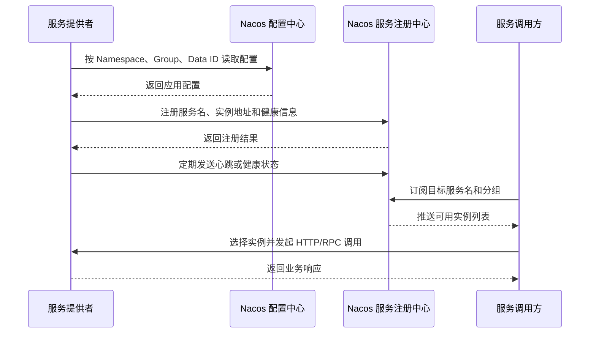

# Nacos：服务发现与配置中心

Nacos 主要解决两个问题：服务实例地址会变化，调用方不应硬编码 IP；多环境配置分散在各实例时，变更和核对容易出错。它既可提供 Naming（注册发现），也可提供 Config（集中配置）。这两个能力相关但职责不同：发现告诉调用方“服务在哪里”，配置告诉应用“启动或运行时使用什么配置”。

## Nacos 中几个容易混淆的概念

| 概念 | Naming 中的作用 | Config 中的作用 | 常见误区 |
|---|---|---|---|
| Namespace | 隔离开发、测试、生产等服务注册空间 | 隔离不同环境的配置集合 | 控制台显示名和客户端使用的 Namespace ID 可能不同，客户端通常需要 ID |
| Group | 对服务或配置做逻辑分组 | 通常与 Data ID 一起定位配置 | Group 不是环境隔离的替代品，命名规则应统一 |
| Service | 一类逻辑服务，例如 `order-service` | 通常用于推导默认配置名 | 服务名必须与实际注册名一致 |
| Cluster | 同一服务内的实例分组，可表达机房/地域等属性 | 不用于替代配置分组 | Cluster 不等同于 Namespace |
| Instance | 服务的一个运行实例，含 IP、端口、健康状态和元数据 | 不适用 | 注册成功不代表调用方网络一定能访问该端口 |
| Data ID | 不适用 | 一份配置的唯一标识 | 文件后缀与客户端解析格式必须匹配 |

典型命名可以是：Namespace 按环境隔离，Group 按团队或业务域组织，Service 按应用名注册；配置由 Namespace、Group 和 Data ID 一起定位。一个团队需要先约定这三层命名，避免“服务注册在 test namespace、配置却读到默认 namespace”。

## 服务注册与发现的完整链路

```text
Provider 启动
  -> 用应用名、namespace、group、cluster、IP 和端口注册实例
  -> Nacos 接收心跳或健康检查
Consumer 启动
  -> 按服务名和分组订阅实例列表
  -> 客户端负载均衡挑选可用实例
  -> 发起 HTTP/RPC 请求
实例下线/不健康
  -> 注册中心更新状态并通知/供客户端刷新
  -> 后续调用避开该实例
```

下面用时序图区分 Config 和 Naming：服务启动时先按约定读取配置，再注册自己的实例；调用方订阅服务名并从健康实例中选择目标。配置中心和服务发现解决不同问题，不能互相替代。



具体客户端可能先加载本地配置或缓存，再连接 Nacos；Naming 列表也可能通过订阅和本地缓存更新。图展示的是逻辑关系，不代表每次业务请求都同步经过 Nacos。

服务发现只提供候选地址，不验证业务接口一定正常。注册中心的心跳、客户端缓存和网络传播都需要时间；实例刚下线时，旧列表可能还会被使用。超时、有限重试、负载均衡和业务降级仍由调用链负责。

### Spring Cloud Alibaba 配置示意

以下是概念示例，属性名和配置加载方式会随 Spring Boot 与 Spring Cloud Alibaba 版本变化。旧版项目可能使用 `bootstrap.yml`；较新版本通常通过 Boot Config Data 机制导入配置。先核对项目的依赖版本和官方兼容矩阵，不要把不同版本文档中的配置片段混用。

```yaml
spring:
  # 客户端注册时使用的逻辑服务名，需和 Gateway/调用方引用名一致。
  application:
    name: order-service
  # 运行环境从部署配置注入，不能把生产 Profile 写死进镜像。
  profiles:
    active: ${APP_PROFILE:dev}
  cloud:
    nacos:
      discovery:
        # 通过环境变量指定可达的 Nacos 地址，不提交真实环境地址或凭据。
        server-addr: ${NACOS_SERVER_ADDR:127.0.0.1:8848}
        # 客户端使用 Namespace ID；需和 Nacos 控制台的环境空间对应。
        namespace: ${NACOS_NAMESPACE_ID:}
        # 服务分组要与消费者和部署约定一致。
        group: ${NACOS_SERVICE_GROUP:DEFAULT_GROUP}
      config:
        # 配置中心地址可与 Naming 使用同一集群，也可能由平台分开提供。
        server-addr: ${NACOS_SERVER_ADDR:127.0.0.1:8848}
        # 配置空间与应用环境匹配，避免读到另一环境的配置。
        namespace: ${NACOS_NAMESPACE_ID:}
        # 配置分组需要与控制台创建配置时选择的 Group 一致。
        group: ${NACOS_CONFIG_GROUP:DEFAULT_GROUP}
        # 告诉客户端配置内容的格式；Data ID 后缀应据此约定。
        file-extension: yaml
```

有些版本把公共地址放在 `spring.cloud.nacos.server-addr`，有些示例分别写在 `discovery` 和 `config` 下；服务注册与配置加载也可能需要不同 starter。排错时以运行时最终生效的 Property Source 为准，而不是只看某一份 YAML。

## 从控制台完成一次本地配置发布

本地学习时，先按项目 README/Compose 文件确认 Nacos 版本、端口、认证和依赖，再进入该实例的控制台。不要直接沿用网上默认账号密码，也不要把控制台端口映射到公网。

本机直接映射默认 HTTP 端口时，常见控制台地址为 `http://127.0.0.1:8848/nacos/`；context path、端口和认证行为可能随版本或部署配置变化，应以当前实例配置为准。

1. 在控制台新建 `dev` Namespace；复制 Namespace ID，客户端配置通常需要这个 ID。
2. 新建配置，填写事先约定的 Group、Data ID 和 YAML/Properties 格式；先从非敏感开关或说明文本开始。
3. 在测试服务设置与之匹配的 Namespace ID、Group、Data ID 后缀和 Nacos 地址。
4. 重启服务确认启动时读取成功，再查看应用日志中的配置来源和实际生效值。
5. 若要测试动态推送，再修改非关键测试配置，确认监听日志、Bean 刷新和回滚行为；不要用密码或生产连接串做练习。

在 datacenter-cloud 仓库根目录可以先检查 Compose 中定义的服务名，再阅读基础设施配置；启动前检查目标环境和配置文件，不要把本地示例直接当作生产部署命令。

```sh
# 列出 Compose 文件声明的服务名，不输出解析后的环境变量值。
docker compose -f docker/docker-compose-base.yml config --services

# 查看指定服务的容器状态，确认它是否已启动以及是否退出。
docker compose -f docker/docker-compose-base.yml ps gykj-dc-nacos

# 查看最近的 Nacos 启动日志；分享前先检查输出是否含内部地址或敏感配置。
docker compose -f docker/docker-compose-base.yml logs --tail=100 gykj-dc-nacos
```

这些命令假设当前目录是源码仓库根目录，Compose 文件和服务名需以当前分支实际内容为准。Nacos 控制台可访问只说明 Web 入口可达；客户端还可能需要通过额外的 Naming/Config 协议端口。

## 在控制台管理一份配置

1. 先选择正确 Namespace，再创建 Group 和 Data ID；按团队约定把应用名、Profile 和格式编码进 Data ID。
2. 内容只放该环境实际需要的配置项。口令、证书和 Token 优先存入密钥管理系统，再通过安全引用注入应用。
3. 保存后检查发布记录和客户端监听日志，确认正确实例收到了对应配置。
4. 如果配置支持动态刷新，在测试环境验证 Bean 是否实际更新、失败时是否保留旧值，以及回滚配置后是否恢复。
5. 对影响连接池、线程池、权限或数据源的配置，先评估热更新的线程安全和资源重建行为；必要时走受控重启。

客户端订阅到新内容，不表示所有 Java 对象都会自动改变。不可变配置对象、启动时初始化的连接池或自定义 Bean，可能需要显式刷新机制。不要用线上“点一下发布”替代版本记录、评审、灰度和回滚。

## 服务注册和配置中心怎样排错

| 现象 | 优先检查 | 浏览器/服务侧证据 |
|---|---|---|
| 服务列表没有实例 | 注册依赖、启动日志、namespace/group、健康状态 | Gateway 返回 503；检查注册日志和 Nacos Naming 列表 |
| 实例在线但 Gateway 502 | 注册 IP/端口、容器网络、防火墙和服务监听地址 | 直连实例失败、Gateway 上游连接错误 |
| 调用错环境/错服务 | Namespace ID、Group、Service 名、Profile | 同一服务在多个环境或分组出现，检查实际配置来源 |
| 配置改了但应用仍用旧值 | Data ID、Group、namespace、监听日志和刷新方式 | 日志显示收到变更但 Bean 值未更新，或客户端根本没订阅 |
| 只在部分实例生效 | 多实例 Profile、配置监听、客户端版本和本地缓存 | 按实例比较配置摘要、启动参数和更新时间 |
| Nacos 页面可打开但应用连接失败 | 客户端访问地址、端口、安全组、DNS 和版本兼容 | 浏览器能访问控制台不代表客户端所需所有协议端口都可达 |

Nacos 2.x 部署除 HTTP 控制端口外还可能使用额外的 gRPC 端口；容器端口、宿主机映射和防火墙都要按对应版本文档核对。不要只检查 Web 控制台端口。

## 安全与可用性

- Naming 和 Config 的网络入口应限制在服务网络或受控管理网段，不将控制台直接暴露公网。
- 开启适配当前版本的认证和最小权限；应用只读所需配置，运维账号单独管理。
- 配置变更应有发布人、变更记录、版本和回滚值。批量改配置前导出或记录当前版本。
- 多实例部署要定义 Nacos 集群、持久化数据库、备份恢复和升级顺序。单机模式适合本地学习，不代表生产高可用。
- 轮询或订阅失败时，应用可能保留本地旧配置；启动失败和运行期配置失联的处理需要按关键程度分别设计。
- 密钥不应进入 Git、前端静态资源、日志或截图；排障输出应先脱敏。

## 在 datacenter-cloud 中阅读

可从仓库 `docker/docker-compose-base.yml` 的 Nacos 服务入手，理解本地单机实例、端口和持久化配置；再阅读 `gykj-gateway` 与各业务模块的 `bootstrap.yml`、Maven 依赖和服务名配置。该 Compose 示例使用 Nacos 2.0.2 单机模式，适合认识本地依赖关系，不应当作生产集群配置。配置文件可能随分支和部署环境变化，学习时只记录属性名和调用关系，不复制实际地址或凭据。

## 常用命令与检查

Nacos 没有跨版本、跨发行版都一致的独立管理 CLI。实际运维通常通过 Docker Compose、控制台和 Nacos Open API；Open API 的路径、认证方式及可用参数会受 Nacos 版本和部署方式影响。先用 `docker compose config --services` 确认 Compose 服务名，再核对当前版本文档，不要把下面的示例当成所有集群都可直接使用的固定接口。

### 检查容器与启动日志

```sh
# 列出 Compose 文件实际定义的服务名，先核对 Nacos 服务名和文件路径。
docker compose -f docker/docker-compose-base.yml config --services

# 查看 Nacos 容器是否处于运行状态；容器运行不等于 Nacos 已完成初始化。
docker compose -f docker/docker-compose-base.yml ps gykj-dc-nacos

# 读取最近 200 行启动日志，定位数据库连接、端口冲突或初始化错误。
docker compose -f docker/docker-compose-base.yml logs --tail=200 gykj-dc-nacos

# 持续观察启动日志；按 Ctrl+C 只会结束日志跟随，不会停止容器。
docker compose -f docker/docker-compose-base.yml logs --follow --tail=100 gykj-dc-nacos
```

若服务名不同，以 Compose 文件中 `services:` 下的键为准。日志可能包含内网地址或配置摘要，转发给他人前先检查并脱敏。

### 从客户端机器验证 HTTP 入口

```sh
# 请求本机控制台入口并显示响应头；200/HTML 只说明 Web 入口有响应。
curl --include --max-time 5 http://127.0.0.1:8848/nacos/

# 检查客户端到 Nacos HTTP 端口是否能建立连接；这不代表 Naming 或 Config 请求已授权。
curl --silent --show-error --output /dev/null --write-out 'HTTP %{http_code}\n' \
  --max-time 5 http://127.0.0.1:8848/nacos/

# 从客户端所在机器检查 Nacos 2.x 常见 HTTP 端口；TCP 建连成功不代表认证或 API 调用成功。
nc -vz 127.0.0.1 8848

# 检查 Nacos 2.x 常见客户端 gRPC 端口；端口偏移和映射依版本/部署而定。
nc -vz 127.0.0.1 9848
```

如果部署修改了 HTTP 端口、context path、TLS 或反向代理路径，要替换示例地址。Nacos 2.x 客户端还可能使用额外的 gRPC 端口；仅有浏览器控制台响应，不能证明客户端的所有协议端口都可达。不要为排错把管理端口开放到公网。

### 使用 Open API 做只读查询

以下是常见 Nacos 1.x 兼容 Open API 的形状，适合在隔离测试环境理解查询参数。Nacos 2.x 和不同发行版可能有路径、参数、鉴权或兼容性差异；执行前先对照当前版本文档。启用了认证的实例还需要按当前版本提供凭据，本文不在命令行中放用户名、密码或访问令牌。

```sh
# 设置本地测试地址；生产地址应从受控环境配置中读取，不要提交到仓库。
NACOS_ADDR='http://127.0.0.1:8848'

# Nacos 默认 public namespace 的 ID 在部分版本中为空；自建 namespace 请填控制台显示的真实 ID。
NACOS_NAMESPACE_ID=''

# 分页查询服务目录；根据实际部署替换 context path 和 namespace 参数。
curl --get --fail-with-body --silent --show-error \
  --data-urlencode 'pageNo=1' \
  --data-urlencode 'pageSize=20' \
  --data-urlencode "namespaceId=$NACOS_NAMESPACE_ID" \
  "$NACOS_ADDR/nacos/v1/ns/service/list"

# 查看一个服务的实例列表；服务名、分组和 namespace 必须匹配注册端设置。
curl --get --fail-with-body --silent --show-error \
  --data-urlencode 'serviceName=order-service' \
  --data-urlencode 'groupName=DEFAULT_GROUP' \
  --data-urlencode "namespaceId=$NACOS_NAMESPACE_ID" \
  "$NACOS_ADDR/nacos/v1/ns/instance/list"

# 只读取一份虚构的测试配置；tenant 用于指定 namespace，参数名称依 API 版本核对。
curl --get --fail-with-body --silent --show-error \
  --data-urlencode 'dataId=demo.yaml' \
  --data-urlencode 'group=DEFAULT_GROUP' \
  --data-urlencode "tenant=$NACOS_NAMESPACE_ID" \
  "$NACOS_ADDR/nacos/v1/cs/configs"
```

服务列表能查到实例，仍需核对实例健康状态、注册 IP 是否能从调用方网络访问，以及端口是否正确。`--fail-with-body` 需要较新的 curl；旧版本可改用 `--include` 查看 HTTP 状态，再按响应体判断错误。

读取配置的 API 会直接返回配置文本，可能包含数据库密码、Token 或内部地址。只在使用虚构、非敏感测试配置时查询；禁止把命令输出粘贴到工单、聊天或 Git。生产配置请通过受控控制台和审计流程查看。启用认证后，认证参数或 Token 的获取方式以部署版本文档为准，不要通过把密钥拼进 URL 来绕过认证。

### 启动与重启的影响

```sh
# 在确认 Compose 文件、环境变量和目标主机后启动本地 Nacos 服务。
docker compose -f docker/docker-compose-base.yml up -d gykj-dc-nacos

# 仅在确认实例允许短暂中断后重启；该操作会影响使用此实例的服务发现和配置读取。
docker compose -f docker/docker-compose-base.yml restart gykj-dc-nacos
```

启动或重启后要依次查看 Compose 状态、Nacos 日志、控制台访问和客户端注册/配置日志。不要把“容器启动成功”当成集群健康或业务调用恢复的证明。

## 练习

1. 在隔离的本地环境启动 Nacos，创建 dev namespace 和一份非敏感测试配置，让一个测试服务注册并读取配置。
2. 故意把客户端 namespace ID、Group 或 Data ID 改错，观察启动日志、配置来源和 Gateway 响应分别如何变化。
3. 修改一项可动态刷新的测试配置，确认哪些 Bean 会更新、哪些资源需要重建，并演练配置回滚。
4. 画出浏览器请求从 Gateway 到服务实例的路径，标出服务名、namespace、实例端口和健康检查位置。

继续学习：[微服务与消息系统](./distributed)、[Gateway、Sentinel、Seata 与 API 工具](./microservice-tools)、[Linux、Nginx 与部署](./operations)。
