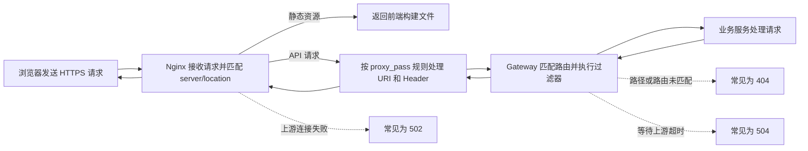

# Nginx：静态资源、反向代理与路径排错

Nginx 可以托管前端构建产物，也可以终止 TLS 并把 API 请求转发到 Gateway。浏览器到 Nginx 与 Nginx 到上游是不同的网络连接；定位 404、502、504 时要把两段 URL、Header 和超时分别核对。

Nginx 根据域名、路径和配置，将流量提供为静态文件或转发给后端。它解决统一入口、TLS 终止、负载分发和路径转发问题。

## 一次 API 请求经过 Nginx 的流程

这张图把前端请求、Nginx 路由和 Gateway 上游连起来，也标出最容易混淆的 404、502、504。遇到路径错误时，逐跳记录 Nginx 收到和转发的 URI。



图中的路径处理取决于 `location`、`proxy_pass`、`rewrite` 等配置。502 通常要检查 Nginx 到上游的连接；504 要继续检查上游处理耗时；404 则要对照浏览器 URL、Nginx 转发 URI 和 Gateway 实际匹配路径。

~~~nginx
# 仅展示反向代理结构；上线配置应结合实际网络安全审阅。
server {
    # 监听示例 HTTP 端口；生产 TLS 参数应由环境统一管理。
    listen 8080;

    # 匹配部署域名；用实际环境的主机名替换示例值。
    server_name app.example.test;

    # 匹配门户 API 路径。
    location /api/ {
        # 将请求转给内网 API 网关。
        proxy_pass http://gateway-service/;

        # 保留原始 Host，便于下游生成正确链接和日志。
        proxy_set_header Host $host;

        # Nginx 直接暴露在可信网络边界时，覆盖客户端可能伪造的 X-Forwarded-For。
        proxy_set_header X-Forwarded-For $remote_addr;

        # 传递原始协议，让后端在可信代理边界内判断外部请求是否为 HTTPS。
        proxy_set_header X-Forwarded-Proto $scheme;

        # 传递直接连接到 Nginx 的客户端地址；多层代理要按受信任代理链配置。
        proxy_set_header X-Real-IP $remote_addr;

        # 设置等待上游响应的上限，具体值应符合接口 SLO。
        proxy_read_timeout 60s;
    }
}
~~~

上例假设 Nginx 是最外层可信入口，`$remote_addr` 是实际 TCP 对端地址。如果 Nginx 前面还有负载均衡器，必须先通过 `set_real_ip_from` 精确配置可信代理地址范围，再配置 `real_ip_header`/`real_ip_recursive` 恢复客户端地址；之后才可以按已审核的代理链转发 `X-Forwarded-For`。不要无条件使用 `$proxy_add_x_forwarded_for` 接受公网客户端自己提交的 XFF，否则后端可能把伪造地址当成真实来源。若 TLS 在前置负载均衡器终止，`X-Forwarded-Proto $scheme` 也可能反映的是 Nginx 到 LB 的内部 HTTP，需使用同样的可信边界处理外部协议。

proxy_pass 尾部斜杠会影响路径拼接。多一个或少一个路径段就可能导致 404，要对比转发前后的 URL，而不只是看前端 API wrapper。

| 配置 | 示例请求 | 发给上游的路径 | 用途 |
|---|---|---|---|
| `location /api/` + `proxy_pass http://gateway/;` | `/api/users/1` | `/users/1` | 用上游 URI 替换匹配到的 `/api/` 前缀 |
| `location /api/` + `proxy_pass http://gateway;` | `/api/users/1` | `/api/users/1` | 保留原始 URI 前缀 |

这是 Nginx `proxy_pass` 在 URI 部分存在或不存在时的常见差异；正则 location、变量和 rewrite 会改变结果。遇到 404 时把浏览器 Request URL、Nginx access log 和 Gateway 实际收到的 path 放在一起比对。

## Nginx 超时和大请求限制

```nginx
# 以下指令放在合适的 server/location 中，并按接口 SLO 与代理链调整。
location /api/ {
    # 等待连接到上游建立的时间；不是整个请求的总耗时。
    proxy_connect_timeout 3s;

    # 将请求体发送给上游时允许的间隔上限。
    proxy_send_timeout 30s;

    # 等待上游连续返回数据的间隔上限；通常不是绝对总时长限制。
    proxy_read_timeout 60s;

    # 限制单个请求体大小；上传上限还要与网关和 Spring multipart 配置一致。
    client_max_body_size 100m;

    # 将符合此 location 的请求转发给 API 网关。
    proxy_pass http://gateway-service/;
}
```

调大某一层的超时或上传上限不会让慢 SQL 变快，也会增加连接占用和资源成本。浏览器、CDN、Nginx、Gateway、应用和 HTTP 客户端要分别核对限制，最小的 body 上限或等待预算会先产生错误。

代理可能改 Host、协议、端口、路径或响应头。应用若要生成绝对 URL，应处理受信任的 forwarded headers，不能无条件相信客户端传入的转发头。

多层代理应由最外层可信入口覆盖或清理客户端自己提交的 `X-Forwarded-*` Header，再由应用只信任明确配置的代理地址。否则攻击者可能伪造来源 IP、协议或 Host，影响访问日志、HTTPS 跳转、Cookie 安全属性和审计判断。

## 前端静态资源与 API 的版本配合

前端静态页面和 API 往往分开发布。带内容哈希的 JS/CSS 文件可以长时间缓存；入口 HTML 通常要及时重新验证，避免旧 HTML 引用已删除的旧 bundle。新旧前端可能在 CDN、浏览器缓存和 Service Worker 中同时运行，因此 API 新增字段应尽量向后兼容；删除字段、修改枚举或改变权限语义前，要确认仍在线的前端版本。

SPA 静态站点可将带哈希的 assets 设置为长期缓存，将入口 HTML 设置为重新验证，并让未知前端路由回退到 `index.html`。API 路由要先于 SPA fallback 命中，避免后端 404 被误返回成一个 HTML 页面。

```nginx
# 示例 root 指向构建产物；真实路径、TLS 和安全响应头应按部署配置评审。
server {
    # 托管前端构建目录。
    root /srv/www/app/dist;

    # 入口 HTML 每次验证，减少客户端持有过期 bundle 清单的时间。
    location = /index.html {
        add_header Cache-Control "no-cache" always;
    }

    # 内容哈希资源可以长期缓存；只有文件名确实带版本哈希时才使用 immutable。
    location /assets/ {
        try_files $uri =404;
        add_header Cache-Control "public, max-age=31536000, immutable" always;
    }

    # 静态文件不存在时交给前端路由处理。
    location / {
        try_files $uri $uri/ /index.html;
    }
}
```

实际 Nginx 配置若还代理 `/api/`，应单独定义匹配规则并确认 API 404 保持为 404 JSON。发布新资源前要确保旧 bundle 在 CDN 缓存窗口内仍可取到，或同时保留新旧版本文件。

## Nginx 常用命令速查

排错时先确认 Nginx 实际使用的配置文件、进程和日志路径。不同发行版、容器镜像或源码安装方式可能采用不同路径和 systemd unit 名；先读状态再执行变更命令。

### 版本、配置与运行状态

```sh
# 查看 Nginx 版本，便于和配置语法、模块能力及部署记录对应。
nginx -v

# 查看编译参数和已编译模块；输出可能较长，适合确认是否包含需要的模块。
nginx -V

# 只测试配置语法及引用文件是否可读，不会重载或停止正在运行的 Nginx。
sudo nginx -t

# 输出合并后的完整配置，适合确认 include 后最终生效的 server/location。
# 警告：结果可能包含内部地址、路径、Header、证书路径或内联凭据，不要直接贴到公开工单。
sudo nginx -T

# 查看 systemd 管理的 Nginx 进程状态和近期退出原因；发行版的 unit 可能名为 nginx 或 nginx.service。
systemctl status nginx --no-pager

# 只读查看 Nginx 主进程及 worker 进程，确认服务是否正在运行。
ps -ef | grep '[n]ginx'

# 检查 HTTP/HTTPS 监听端口及关联进程；权限不足时 PID 信息可能被隐藏。
sudo ss -lntp | grep -E ':(80|443|8080)\b'
```

如果 `nginx -t` 报错，优先修复第一条语法或文件路径错误，再重复测试。测试成功只说明配置可解析，不证明域名、证书、上游服务、文件权限和业务路径都正确。

### 日志和请求联调

常见日志路径是 `/var/log/nginx/access.log` 和 `/var/log/nginx/error.log`，容器环境也可能把日志输出到标准输出。实际路径以 Nginx 配置和部署方式为准。

```sh
# 查看最近的访问日志，核对请求路径、状态码和请求时间；日志可能带用户标识，应按隐私要求处理。
sudo tail -n 100 /var/log/nginx/access.log

# 持续跟踪访问日志，复现浏览器请求时确认请求是否到达 Nginx；Ctrl+C 只退出查看。
sudo tail -n 100 -f /var/log/nginx/access.log

# 查看最近错误日志，重点找 upstream、permission denied、open() failed 等信息。
sudo tail -n 100 /var/log/nginx/error.log

# 按域名请求本机入口；本页反代示例监听 8080，Host Header 让 Nginx 选择对应 server 块。
curl --max-time 5 -i -H 'Host: app.example.test' http://127.0.0.1:8080/api/health

# 绕过 DNS 将指定域名解析到本机地址，同时保留域名 Host 和 TLS SNI。
curl --max-time 5 -i --resolve app.example.test:443:127.0.0.1 https://app.example.test/api/health

# 检查一个静态资源响应状态和缓存 Header，不下载完整响应体。
curl --max-time 5 -sSI https://app.example.test/assets/app.examplehash.js

# 在 Nginx 主机上直连真实上游；端口应使用 Gateway/服务端口，不要误填本页示例的 Nginx 监听端口 8080。
UPSTREAM_HOST=gateway.internal
UPSTREAM_PORT=8081
curl --max-time 5 -i "http://${UPSTREAM_HOST}:${UPSTREAM_PORT}/actuator/health"

# 另行检查经过 Nginx 的路径；按本页示例，Nginx 自身监听 8080 且会把 /api/ 前缀替换掉。
curl --max-time 5 -i -H 'Host: app.example.test' http://127.0.0.1:8080/api/actuator/health
```

可以用这条路径区分故障位置：浏览器 Network 是否发出请求 → Nginx access log 是否记录 → Nginx error log 是否有 upstream 错误 → Gateway/API 是否收到请求。`502` 常见于连接失败或上游提前断开，`504` 常见于等待上游超时；最终原因必须结合 error log 和上游日志确认。

### 配置变更与重载

测试环境可先演练以下流程。配置检查是只读操作；reload 会影响运行中的 Nginx，但通常以平滑方式让 worker 切换到新配置，已有请求可由旧 worker 完成。不要在未检查配置、未确认目标主机时直接重启。

```sh
# 第一步：检查配置语法和 include 文件；失败时先修配置，不要继续重载。
sudo nginx -t

# 第二步：仅在配置检查通过且发布窗口允许时，请求 systemd 对 Nginx 做平滑重载。
sudo systemctl reload nginx

# 第三步：确认服务仍为 active，且没有因新配置启动失败。
systemctl status nginx --no-pager

# 第四步：从本机请求目标域名与路径，确认新路由和响应码符合预期。
curl --max-time 5 -i -H 'Host: app.example.test' http://127.0.0.1/api/health
```

如果服务由容器运行，应针对对应容器或编排服务检查配置并使用平台定义的 reload 流程，宿主机的 `systemctl reload nginx` 不会重载容器内 Nginx。直接运行 `nginx -s reload` 也会向 master 进程发送重载信号，属于运行状态变更；先通过 `nginx -t`，并确认 PID 文件和目标实例正确。`restart` 会重建进程并可能中断连接，只有 reload 不适用且变更方案允许时才考虑。

不要把日志清空、删除 PID 文件或杀死所有 Nginx 进程作为常规排错步骤；这会丢失证据或影响服务。配置更新失败时，检查 systemd/error log，并按发布流程恢复已知可用的配置版本。

## Nginx 排错练习

1. 在测试环境用两种 proxy_pass 写法转发同一路径，对比 Gateway 实际收到的 URI。
2. 用 Network 和 Nginx access log 对照一个 404，判断是静态路由、代理路径还是 API 路由问题。
3. 发布一个新前端 bundle，检查入口 HTML 的缓存头和旧 hash 文件是否仍可访问。
4. 对大文件上传请求分别记录浏览器、Nginx、Gateway 和 Spring 的体积上限。
5. 检查转发 Header 是否由可信代理覆盖，并验证后端只信任受控代理地址。

继续学习：[Linux 服务运行](./linux.md)、[计算机网络基础](./network.md)、[微服务与消息系统](./distributed.md)。
